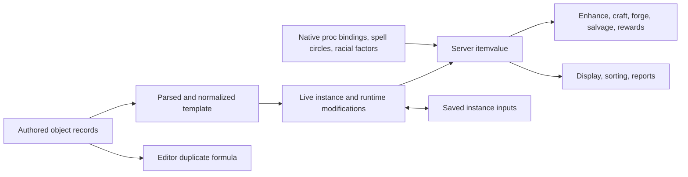

# Ival system: end-to-end review and improvement plan

Status: implementation in progress; review findings remain open unless recorded
as completed in the implementation log below.
Reviewed: 2026-11-09.
Baseline: `8e254bc0dd0be09ecf99822573ff5edde4373293`, local branch
`branch/confirm-character-deletion-name`. The checkout was clean before this review.

Follow-up verification, 2026-11-09: the checkout has advanced to
`4059a94a3fb1d4613b5bb21d74483074e50e3747`. Commit `a033caabf` removed the flat-file
server backend. The current [build](../../src/Makefile#L56) accepts only MariaDB,
and [runtime configuration](../../src/persistence/persistence_mode.c#L21) accepts
only `mariadb-primary`. Implementation and persistence journeys are therefore
scoped to MariaDB. The original review's evidence remains tied to the baseline
above; recheck findings against the implementation checkout before making changes.

## Outcome, scope, and proof

Make item valuation consistent, explainable, numerically safe, and cheaper to use,
with one authoritative calculation and explicit consumer policies. This review
covers authored and generated items, server/editor calculations, native and packed
procs, enhancement, crafting/forging, salvage, rewards, reports, presentation,
and the persistence of valuation inputs.

The original review delivered this plan without gameplay implementation, tuning,
deployment, migration, player-data changes, or production operations. The user
subsequently authorized implementation, focused commits, pushes, and labeled PRs.
Temporary native probes from the original review were
built under `bin/tests/ival-audit-20261109/`; compiled artifacts are not committed.
Automatic approval review blocked their deletion, including exact-file cleanup,
so these ignored local evidence files remain. No detailed rejection reason was
provided beyond “blocked by policy.”

The initial review evidence consists of direct source tracing, execution of unchanged native
valuation functions, sanitizer boundary probes, an authored-object inventory,
and ten existing focused checks. It is **not** a live-server or full-world
qualification. Subsequent native corpus and implementation qualification is
recorded in the log below. Source links and line
anchors refer to the reviewed baseline.

## Implementation log and handoff

Implementation checkout:
`C:/Users/apexw/.codex/worktrees/ival-system-improvements/duris`.
Matching remote checkout on `duris-staging`:
`/home/staging/duris-worktrees/ival-system-improvements`.
Both checkouts use the tracked plan at
`docs/ongoing-projects/ival-system-review-plan.md`. The remote checkout tracks
`origin/branch/ival-material-bounds`; its initial synchronized commit was
`c9822bbd3` on the constructor-repair branch. Only committed work is synchronized.
These are development worktrees;
creating them does not deploy or change the running server.

Initial implementation branch: `branch/ival-system-improvements`, plan commit
`df2bfe359`, based on `c5db5ed5b`. Persistence remains MariaDB only. Dependent
implementation chunks will use stacked branches/PRs; no release tag or deployment
is appropriate before review and qualification.
Plan PR: [#876](https://github.com/LuminariMUD/Duris/pull/876), against `master`.

Current Git status verified 2026-11-09: PRs #876, #877, #878, #879, #884, #885,
#886, #889, and #894 were merged by external review. PR #902 targets `master`;
the #919 constructor repair and #927 CTF binding prerequisite are stacked above
it. The metadata/report work is published as #930; the circle repair is #935 on
`branch/ival-circle-extents`; #946 repairs packed averaging on
`branch/ival-packed-proc-mean`; #956 supplies canonical apply composition on
`branch/ival-apply-composition`; #959 makes zero modifiers neutral on
`branch/ival-zero-modifiers`; #960 qualifies duplicate apply totals on
`branch/ival-duplicate-applies`; #964 repairs numeric overflow/unavailable-value
admission on `branch/ival-numeric-bounds`; #966 shares checked material quantities
and plans crafting XP on `branch/ival-material-bounds`. Branch/base
descriptions below record the
original delivery order. The worktree incorporates reviewed master `341bd84ee`
through non-rewriting merge `0f61c60f7`; no production deployment was performed by
this task. Refresh remote state before continuing if other review work advances it.

### Chunk 1 — remove unused reset/recovery valuations (F15, partial)

Branch: `branch/ival-reset-admission`, based on `branch/ival-system-improvements`.
Published: commit `5578459f7`, [PR #877](https://github.com/LuminariMUD/Duris/pull/877)
(enhancement label), stacked on #876. This chunk is ready for review.

**Outcome:** item load admission takes only the object and zone chance. Remove
the unused score argument, seven reset evaluations, the recovery evaluation, and
the unused `equipped_value()` helper with its retired commented caller.
Artifact halving, chance comparison, shopkeeper exceptions, and RNG draws retain
their existing behavior.

**Non-goals:** formula changes, balance changes, locker sorting, and deployment.
F15's locker work and stale valuation descriptions remain pending.

**Files:** `src/core/{utility.c,utils.h,prototypes.h}`, `src/world/{db.c,
world_recovery_npc_items.c}`, the dead helper/caller in `src/classes/drannak.c`
and `src/combat/fight.c`, and their focused reset/recovery harnesses.

**Proof:** a native sanitizer regression executes the production load check for
all 100 random outcomes across ordinary/artifact objects and nine chance values
(1,800 cases), asserting one RNG draw per attempt. The following checks passed:

```text
python3 tests/async/test_item_load_check.py
python3 tests/async/test_castle_key_reset.py
python3 tests/async/test_elemental_groves_key_reset.py
python3 tests/async/test_artifact_creation_admission.py
python3 tests/async/test_world_recovery_npc_items.py
python3 tests/async/test_world_recovery_pipeline.py
python3 tests/async/test_npc_missing_item_material_fallback_contract.py
./scripts/format.sh --staged --check
make -C src -j4
```

The native tests use ASan/UBSan, except the material fallback source contract.
The server binary is `bin/server/dms_new`. This chunk changes neither persistence
nor commands, so it requires no database migration or live-server operation.

Local tooling: run Linux commands through WSL in the Windows worktree. WSL Git
needs `GIT_DIR=/home/aiwithapex/projects/duris/.git/worktrees/duris1` and
`GIT_WORK_TREE=/mnt/c/Users/apexw/.codex/worktrees/ival-system-improvements/duris`.
Use `core.fileMode=false` and `core.autocrlf=true` for that mixed-filesystem
checkout. Keep the three existing hook/format/tidy scripts locally LF when running
Linux hooks; do not commit newline-only changes. The host's default clang tooling
selects GCC 16 headers; GCC 13 standard include paths are needed for the installed
clang tooling to parse this checkout. This is local tool selection, not a source
or warning-policy exception.
The commit hooks passed with `CLANG_TIDY=/usr/bin/clang-tidy-18` and
`CPLUS_INCLUDE_PATH=/usr/include/c++/13:/usr/include/x86_64-linux-gnu/c++/13:/usr/include/c++/13/backward`.
On this NTFS checkout, the worktree/revision form of `git clang-format --diff`
can produce only synthetic `100644 -> 100755` mode changes despite
`core.fileMode=false`. Keep source modes unchanged. Staged formatting checks and
direct `clang-format --style=file --dry-run --Werror <touched files>` verify the
actual content; use a native Linux checkout for the final revision-wide wrapper
check if its mode-only artifact persists.

**Ablation:** this independent part of Stage 4 can land before evaluator changes
because it removes a dependency that never affects load admission. Updating the
existing interface and callers needs no new valuation/cache/index abstraction.

### Chunk 2 — make the calculation defects reproducible (Stage 1, partial)

Branch: `branch/ival-characterization`, based on `branch/ival-reset-admission`.
Published: commit `30861debb`, [PR #878](https://github.com/LuminariMUD/Duris/pull/878)
(enhancement label), stacked on #877. This chunk is ready for review.

**Outcome:** `tests/async/test_item_value_characterization.py` runs the native
`itemvalue()`, `get_mincircle()`, and `get_ival_from_proc()` implementations. It
loads real spell-circle registrations through `skills.c`'s existing `_PFILE_`
path; epic non-spell registration is omitted. Distinct inert callback identities
allow the real native-proc price resolver to execute without invoking gameplay.
Racial factors are fixture data, so this is not full runtime-context parity.

**Non-goals:** fixing/approving the pinned legacy behavior, active-world deltas,
new weights, persistence qualification, or a replacement Python calculator.
Assertions marked `LEGACY Fxx` must change with their corresponding repairs.

**Files:** this native test and this handoff document only.

**Proof:** `python3 tests/async/test_item_value_characterization.py` passed under
ASan/UBSan/float-cast-overflow. It covers real earth-form/tomb registrations,
first/last class/spec boundaries, invalid/unregistered IDs, packed averaging and
rounding, level 19/20, apply order, zero slots, fourth slot, duplicates/cancellation,
byte extremes, first-match proc precedence, fallback, utility sentinel failure,
packed/native double credit, a gapped glove, and unpriced B5. Ordinary cases
produce no sanitizer errors; isolated subprocesses deliberately reproduce and
assert the two F08 sanitizer failures. Repeated scoring preserves object/index
inputs and consumes no RNG.

`python3 tests/async/test_weapon_actions_runtime.py` also passed, executing the
real packed/glove dispatcher and scheduler, including malformed/gapped glove
refusal. This establishes the other side of the pinned valuation/routing mismatch;
it does not complete F09's entire native-route inventory.

**Ablation:** extend the existing extraction/sanitizer pattern with one focused
test. Share actual registration/valuation code rather than copied formulas or
new test infrastructure. No runtime code changes or server rebuild are needed
for this test-only chunk.

### Chunk 3 — propagate material-report output failures (F07, partial)

Branch: `branch/ival-report-errors`, based on `branch/ival-characterization`.
Published: commit `581972d18`, [PR #879](https://github.com/LuminariMUD/Duris/pull/879)
(bug label), stacked on #878. Formatting and clang-tidy commit checks passed.

**Outcome:** the writer returns failure when directory/file creation, writes, or
stream closure fails, and the report command exits nonzero. All four streams are
closed even on write failure, and success is reported only after successful
closure. Partial files are explicitly identified as unusable. Output paths use
`std::string`, removing fixed 512-byte path truncation found during this repair.

**Non-goals:** context initialization, valuation changes, recipe/denominator
changes, atomic publication, or production reporting. F07 remains open for
native-proc, circle, and racial context plus server/offline parity. A successful
I/O status does not yet establish that the report's scores match a normal boot.

**Files:** `src/item/material_rarity.{h,c}`, the report branch in `src/net/comm.c`,
and the extended `tests/async/test_material_rarity_report_contract.py`.

**Proof:** the extended test passed under ASan/UBSan. It compiles the production
writer and actual report-command branch with an empty catalog and exercises new
and existing output directories, missing parents, a nondirectory target, all four
file-open failures, buffered and unbuffered `/dev/full` write/close failures for
each stream, and paths longer than 512 bytes. Failed commands return 1; successful
commands return 0 and produce the expected files/denominator description. This
test isolates output handling; valuation endpoints must not be called.

`make -C src -j4` passed. The actual `bin/server/dms_new` report CLI was also run
against an isolated temporary empty object catalog: normal output returned 0,
missing-parent output returned 1, and `/dev/full` output returned 1. It exited
before database/listener startup; no live environment or player data was used.

**Ablation:** extend the existing report test and return a boolean through the
existing caller. No error framework, output transaction, or new report mode is
needed. The path change removes truncation rather than adding another limit.

### Chunk 4 — isolate shared arithmetic from runtime context (F11, partial)

Branch: `branch/ival-shared-evaluator`, based on `branch/ival-report-errors`.
Published: implementation commit `efd8d50ea`, evidence commit `810c9bd72`,
[PR #884](https://github.com/LuminariMUD/Duris/pull/884) (enhancement label),
stacked on #879. Ready for review.

**Outcome:** move the existing numeric calculation into `src/item/item_value.c`
with plain input/context data in `item_value.h`; move circle/proc/racial resolution
and the compatible `itemvalue(P_obj)` entry point into `item_value_runtime.c`.
Expose the base, multiplier, unrounded value, floor/utility policy, and score from
the same calculation. Preserve all legacy arithmetic and coefficients in this
extraction, including the defects pinned in Chunk 2.

**Non-goals:** arithmetic repairs, new weights, full context initialization,
editor migration, or full-world delta qualification in this structural slice.
Those original requirements remain open and will use this shared calculation.
The legacy circle/proc-price definitions remain in `tradeskill.c` for the
separate metadata extraction; the new engine adapter resolves them. The current
breakdown contains scalar totals, not yet per-term/unsupported-input diagnostics.

**Files:** the item valuation module, `src/Makefile`, removal of the numeric implementation
from `src/economy/tradeskill.c`, and the existing native valuation harnesses.

**Proof:** the extraction matched the native function from commit `7b994069e` on
25,000 synthetic mixed-input fixtures seeded with `0x4956414c`, with no score
deltas. The comparison compiled both implementations under ASan/UBSan and checked
object/index immutability, zero game-RNG use, and breakdown consistency. It is
structural parity evidence, not the effective-world delta report required for
formula changes. Controlled circle/native/racial context was shared by both
implementations.

The existing enhancement, monk tools, authored monk pilot, and characterization
checks passed with the production numeric module and adapter linked as separate
translation units.
The characterization harness now also compiles the numeric module alone in both
server and `_DE_` editor modes, without engine globals/stubs; it exercises explicit
context, floor/utility policy, and scalar breakdown consistency. Native racial
adapter checks cover resolved factors and invalid modifiers. The known F08
overflow subprocesses still fail as expected; this extraction does not repair
them. `make -C src -j4`, formatting, and clang-tidy commit checks passed.

**Ablation:** one numeric implementation and a thin engine adapter serve the
traced runtime/editor/report consumers. Keep current proc pricing and circle
policy intact; a new rule engine, calculator language, or persistent cache adds
nothing needed by this extraction.

### Chunk 5 — use shared arithmetic in the editor (F06, partial)

Branch: `branch/ival-editor-values`, based on `branch/ival-editor-formatting`.
Published: `28ca386e6`, [PR #886](https://github.com/LuminariMUD/Duris/pull/886)
(bug label), stacked on #885. Ready for review; formatting commit checks passed.

Formatting prerequisite: `64b11e3b7`,
[PR #885](https://github.com/LuminariMUD/Duris/pull/885) (enhancement label),
stacked on #884. `menudef.cpp` and `misc/menu.cpp` failed the repository's
whole-file format check even at baseline `810c9bd72`. This separate PR contains
only clang-format output from those baseline files, keeping the actual estimate
UI/editor changes out of the mechanical diff. Both maintained editor builds
passed after normalization; there is no text or behavior change in #885.

**Outcome:** replace the obsolete editor calculation with a field adapter to the
shared numeric module. Count all four applies, use the same arithmetic for
common inputs, label the view/search as estimates, and explain missing native
proc/racial/specialization context. Correct editor class bounds and remove the
obsolete commented-out native-price copy.

**Non-goals:** inventing native/racial weights, changing server scores, or claiming
complete template/context parity. Missing contexts remain visible; complete
context and normalization must still be reconciled under F07/F11/F12.

**Files:** `areas/de/src/obj/object.cpp`, the GODMODE editor build, its value label,
and existing server/editor native tool fixtures.

**Proof:** `python3 tests/async/test_monk_glove_tools.py` passed under ASan/UBSan.
Server/editor fixtures now agree for HP +10 (29), nonweapon hitroll +3 (37), armor
AC 10 (15), fourth-slot STR +6 (25), protection from living (45), and ordinary 2d6
weapons (12). Legacy zero-modifier behavior is shared, pending its separate repair.
The actual editor search executes with presentation/index endpoints controlled:
its warning is visible and its filter uses the same score as the item view. Real
editor minimum-circle code covers first/last classes, invalid IDs, and the unused
sentinel entry. The editor gives no invented racial credit when context is absent.

`make -C areas/de/src -j4`, `make -C areas/de/src -f Makefile.debug -j4`, and
`make -C src -j4` passed. Physical terminal/menu layout and complete live-context
parity remain unverified. `./scripts/format.sh --staged --check` passed for changed
lines and all touched files after the formatting prerequisite above.

**Ablation:** remove the copied formula and unused commented proc map. Reuse the
existing shared-C wrapper/build pattern, adding no service, import format, or
second authoritative calculator.

Additional required repair discovered while tracing the editor: its reader has
no `B5` branch and aborts on that valid server object record; `objectType` and the
writer also lack bank 5. Repair this in a separate chunk with a native read/write
round trip before claiming editor input preservation. No authored/player data
was modified. This extends the original F05/F06/F16 coverage requirement.
Owning sources are `areas/de/src/obj/{object.h,readobj.cpp,writeobj.cpp}`. The
reader's unrecognized-extra-data branch rejects `B5`; preserve ordinary records
and apply/description/trap ordering when adding support, and copy bank 5 into the
new valuation input without introducing an unreviewed weight.

### Chunk 6 — preserve bank 5 through editor object I/O (implemented)

Branch: `branch/ival-editor-b5-roundtrip`, based on `branch/ival-editor-object-formatting`.
Published: [PR #894](https://github.com/LuminariMUD/Duris/pull/894) (bug label),
implementation `c697d5e7b` and evidence `a8b6f2311`, stacked on #889.
Formatting prerequisite: `a3b901b18`,
[PR #889](https://github.com/LuminariMUD/Duris/pull/889) (enhancement label),
stacked on #886. Only pre-existing formatting drift in the object structure,
reader, and writer is changed there; both editor builds passed.

**Outcome:** read and write the server's optional `B5` record without losing the
fifth affect bank or following descriptions/applies/traps, and pass that bank to
the shared evaluator. Preserve legacy records without `B5`. Reject malformed or
out-of-range masks rather than narrowing them silently.
The authored mask and shared input explicitly retain all 64 bits; the legacy
editor's other bank fields remain unchanged. Clone/equality behavior includes B5.

**Non-goals:** new valuation weights, new editor flag menus, player persistence,
or a new object-file dialect. This is authored content I/O, not a server storage
backend; player persistence remains MariaDB only.

**Files:** `areas/de/src/obj/{object.h,readobj.cpp,writeobj.cpp,object.cpp}`, the
object-save declaration and callers in `fh.h` and `misc/misc.cpp`, and a focused
native reader/writer regression. Formatting prerequisites remain separate commits.

**Proof:** `python3 tests/async/test_editor_object_roundtrip.py` passed with the
production reader/writer, clone/comparison code, and real lexical/description/
keyword helpers under ASan/UBSan. There are 74 valid round trips, including absent
and zero B5, every mask bit, the full 64-bit mask, leading whitespace, same-line
and next-line masks, all four applies, descriptions/traps, and following records.
Malformed, duplicate, overflowing, and overlong masks exit cleanly without
sanitizer findings. The real editor valuation adapter also forwards the full B5
mask to a controlled numeric endpoint; this is field-transfer proof, not a new
valuation weight. Existing `test_monk_glove_tools.py` checks passed with the actual
shared numeric module.

Native boundary testing found the reader's 512-byte buffer violated the lexical
helper's documented three-byte reserve. Its allocation now includes that reserve.
The compiler also flagged a progress-message overflow in the full file writer;
the pathname itself was assembled into another unchecked fixed buffer. Separate
commit `8b7438a71` replaces both with strings. The native test executes the full
writer with a valid nested path longer than 512 bytes and an oversized filename,
verifying success or a normal open error without buffer overflow.

Independent PR review reproduced a tab/vertical-tab-prefixed negative mask on
the next line being accepted as unsigned. The reader now normalizes whitespace
at that boundary before sign validation; positive forms still round-trip.
Review also reproduced the full save workflow clearing `g_madeChanges` after an
object write to `/dev/full` failed. The object writer now reports open/write/close
failure, the full save returns before clearing dirty state, and object-only mode
retains its retry/discard prompt. The existing native harness executes the real
`writeFiles()` with other area writers doubled: success clears dirty state;
open failure and buffered/unbuffered write failures preserve it. Failed output
may be partial and is reported as such; this does not introduce multi-file atomic
publication. The additional save-workflow formatting is isolated in `7b3346403`.

Both maintained editor builds and `make -C src -j4` passed. Formatting/clang-tidy
commit checks passed, and direct whole-file clang-format checks passed for all
five touched C/C++ files. The revision-wide wrapper check produced only the NTFS
mode artifact described above, with no text diff. Implementation: `c697d5e7b`;
the filename repair is the preceding `8b7438a71` commit.

External review merged this work in #894 / `341bd84ee`, adding rejection of
indented next-line negative masks and propagation of object-save errors so the
editor keeps dirty state after open/write/close failure. Those reviewed changes
are retained after merging master into this worktree. The expanded native object
test passed 74 valid round trips, all invalid-mask cases, and successful/failed
save-zone workflows after integration. The binding-catalog test, full server
build, and both maintained editor builds also passed after that integration.

**Ablation:** one stored field and one optional record in the existing parser and
writer suffice. Reuse the native I/O helpers; no parallel parser, converter,
framework, or valuation-policy change is needed.

### Chunk 7 — expose compiled object bindings without boot side effects (implemented)

Branch: `branch/ival-object-binding-catalog`, based on `branch/ival-editor-b5-roundtrip`.
Published: `e723e27bc`, [PR #902](https://github.com/LuminariMUD/Duris/pull/902)
(enhancement label), stacked on #894. Ready for review.

**Outcome:** make the existing 479 object-stage and 20 room-stage object bindings
available as immutable metadata. Normal boot applies those same stage-specific
tables, and offline context can consume them without mobile/room/ship setup or
native callback execution. Preserve assignment order, overrides, missing-vnum
fallback policy, and the `no_specials` boot gate.

**Non-goals:** native-proc repricing, fixing the legacy index-0 fallback, board or
generic-switch wiring, full offline boot/context, or formula changes. Other binding
owners and normalized object fields must still be reconciled before F07 is done.

**Files:** `src/specs/specs.assign.c`, a small metadata header, and affected
binding/valuation regression checks. No new service, registry framework, dynamic
configuration, or callback execution path is needed.

**Proof:** the following checks passed:

```text
python3 tests/async/test_object_binding_catalog.py
python3 tests/async/test_spec_assign_vnums.py
python3 tests/async/test_chaos_kit_policy.py
python3 tests/async/test_tutorial_spellup_bindings.py
python3 tests/async/test_world_quest_target_retries.py
make -C src -j4
clang-format --style=file --dry-run --Werror src/specs/specs.assign.c src/specs/object_bindings.h
```

The authored-world check still covers 1,286 assignments and 12 guild-guard
placements. Quest validation passed 317 native target/creation/payment cases
plus history-policy scenarios. These are isolated executable checks, not live
MUD or database qualification. Formatting/clang-tidy commit checks passed.

The native extraction comparison against `a8b6f2311` matched all 499 resulting
bindings and their lookup sequence across 17 complete/partial-world cases. It
also verified unchanged non-object boot code tokens and no preprocessor
conditionals in the moved assignments. `test_object_binding_catalog.py` compiles
the actual binding translation unit with distinct inert callback identities;
it exercises immutable inspection, separate stages, the vnum-30 override,
missing-vnum fallback, and empty catalogs without callback execution or linked
world/mobile/object-creation services. This is binding parity, not full valuation
or native-callback behavior qualification.

Binding owners to reconcile next include `src/cmd/boards.c` (board metadata),
`src/economy/{mining.c,nexus_stones.c}`, `src/kingdom/{kingdom_guards.c,
kingdom_harvest.c}`, `src/mob/studioproc.c`, `src/combat/ctf.c`, and the generic
switch in `src/world/db.c`. Trace their owning initializers before invoking them
offline; pointer assignment must be separable from runtime/data-loading work.
`src/specs/specs.library.c:proclibObj_add()` also installs
`proclib_obj_cmd_bridge` while remembering an incumbent, and invokes a library's
`CMD_SET_PERIODIC` hook. Consequently, constructor-side proc-library behavior
and incumbent routing must be modeled explicitly; raw fields plus the compiled
catalog alone do not prove normalized live-score parity. Reconcile this with
F05/F07/F09/F11/F12 before treating corpus output as authoritative.

### Chunk 8 — read-only normalized template valuation and offline context (implemented)

Branch: `branch/ival-readonly-template-runtime`, based on `branch/ival-ctf-binding-metadata`.
Published: `a61a6b8f1`, [PR #930](https://github.com/LuminariMUD/Duris/pull/930)
(enhancement and bug labels), stacked on #927. Ready for review.

**Outcome:** evaluate normalized template fields through the shared calculation,
without object creation, UID allocation, callbacks, or events. Share the existing
power-field normalization and proc-library parameter decoding. Initialize spell,
racial/property, and effective binding metadata for offline reporting, and replace
report-only live-object reads with the existing template cache. Record provenance
and fail on missing required context instead of publishing guessed scores.

**Non-goals:** coefficient changes, arithmetic fixes, new proc weights, full game
boot, database access, or a parallel parser/calculator. Existing legacy scoring
and explicit no-registration policy remain intact in this context repair.

**Files:** the valuation adapter and normalization owner, proc-library metadata,
binding owners' data-only setup, property loading, offline object/report boot,
and native context/parity tests.

**Proof:** native runtime/template score and field parity for stat, native proc,
packed proc, racial, armor/shield, ignored, and normalization fixtures; real
decoder/valuation functions; zero inspection UID/event/object-count changes;
offline CLI context/error/provenance checks and effective-world qualification.

**Ablation:** reuse the template parser/cache, shared numeric evaluator, actual
decoders, and binding tables. Split metadata loading from runtime startup only
where the offline caller needs it; add no service, rule engine, input dialect,
or persistent item-score cache.

#### Constructor repair discovered by native parity qualification

Branch: `branch/ival-proclib-event-ownership`, based on `branch/ival-object-binding-catalog`.
Published: `c9822bbd3`, [PR #919](https://github.com/LuminariMUD/Duris/pull/919)
(bug label), stacked on #902. The focused regression and full server build passed.
The real engine comparison found that `instantiate_object_template_impl()` reset
`obj->nevents`/`nevents_tail` after `proclibObj_add()` had attached a periodic event.
Extraction then could not cancel it: the hummer reference left one scheduled
event after its object was freed. Remove this late reset; the constructor's
initial `memset` already initializes both owner lists before registration.

`python3 tests/async/test_newbie_object_template.py` passed under ASan/UBSan with
new assertions that both accepted and no-argument libraries retain their event
owner links. This is an independent lifecycle fix, published before the larger
read-only feature. The full real-engine comparison remains part of Chunk 8 and
will verify cancellation with actual library/scheduler/cleanup code.

Next: finish the native binding/context catalog and full-context reporting.
The CTF prerequisite is published as `74c2975a9`,
[PR #927](https://github.com/LuminariMUD/Duris/pull/927) (bug and enhancement
labels), stacked on #919. Its data-only binding helper checks missing templates
before indexing, fixing the existing `obj_index[-1]` write. Normal boot retains
per-flag binding/construction order. Native absent/present/repeated/index-zero
checks passed under ASan/UBSan; no SQL, callbacks, or flag creation are linked.

The shared arithmetic now supplies the server and editor; do not reintroduce a
copied formula while completing diagnostics and template normalization.
Published parent chunks have been merged externally; current PR state is recorded
at the start of this implementation log. No deployment was performed by this task.
No formula-changing slice is complete without the delta qualification below.

Chunk 8 implementation: the template overload shares
the numeric adapter, converter power-field normalization, and actual proc-library
parameter decoders. Offline boot loads properties/racial factors, spell circles,
compiled bindings, board metadata, object-only Studio records, and the configured
kingdom/nexus/mining/CTF bindings in normal boot order. It does not allocate object
or event pools. Bind the calling thread before Studio metadata publication; the
native effective-world test exposed this previously missing boot prerequisite.
Kingdom metadata models a healthy configured boot, not a database-failure fallback.
The report uses cached templates and records formula/source/binary/world/config
identity; missing properties, parse failures, and output/fingerprint failures are
errors. Recipe arithmetic and legacy coefficients remain unchanged.

The real engine fixture has passed stat-only/native/packed/racial/armor/shield,
ignored and zero-dice normalization, hummer/transporter/invalid-library, and
native-plus-library comparisons. Inspection changes no UID/RNG/object/event or
binding state; actual construction and extraction now cancel library events.
The expanded fixture also checks configured binding owners and skipped non-object
Studio targets. `test_item_value_template_runtime.py` links the production server
objects, controlling only UID allocation and RNG. Its effective-world reference
uses the native AREA builders and production parser/constructor. Object script
validation resolves mobile/room references, so offline boot also loads the native
mobile index, zones, and rooms; no resets or entity creation run. Their files are
included in provenance. The reference callbacks also require this context:
`zombies_game` binds a mobile and `charon_ship` resolves its ferry room before
checking the command. Zone loading has an explicit metadata call that skips
randomized reset-timer initialization; ordinary boot keeps its existing random
draws and timer semantics.

**Final qualification:** all **19,334 indexed templates** assembled from the
active `areas/AREA` manifest passed native constructor-versus-template score
comparison. The reference uses production constructors, callbacks, converter,
valuation, scheduler, and extraction; only UID allocation and RNG endpoints are
controlled. The inspection path creates no identities/objects/events, consumes
no RNG, and preserves input and binding state. The enabled-kingdom fixture and
object Studio record with real mobile/room references also passed. This is a
disposable native metadata fixture, not a live server or player-data journey.

The actual offline CLI matched every reference score in recipes/exclusions.
SHA-256 checks matched the executable, objects, mobiles, rooms, zones, properties,
Studio triggers, item abilities, and kingdom config. Minimal and no-specials
CLI modes passed with the correct provenance flags. Missing properties fail
before reporting. Native I/O regressions passed missing-template and unreadable
fingerprint failures, plus output create/open/buffered/unbuffered/close failures.
The revision writer passed exported-source fallback, dirty Git identity, and
unchanged-header stability checks.

Server and both maintained editor builds passed. Characterization, enhancement,
report output-failure/missing-template checks, racial shrug, proc-library bridge,
Nexus loader/runtime, mining and kingdom contracts passed. Legacy F08 sanitizer
failures remain explicitly characterized, not repaired. Changed-line and
whole-file formatting checks passed. Publication is stacked on #927. Continue
the remaining input coverage, proc-route metadata, arithmetic fixes, consumer
deltas, and MariaDB command/persistence journeys; this structural work does not
complete F01–F16.

### Chunk 9 — include every class/specialization circle registration (F01, implemented)

Branch: `branch/ival-circle-extents`, based on `branch/ival-readonly-template-runtime`.
Published: `7ef2f2299`, [PR #935](https://github.com/LuminariMUD/Duris/pull/935)
(bug label), stacked on #930. Ready for review.

**Outcome:** scan the actual class and specialization array extents, including
class zero and specialization four. Preserve invalid-spell result 0 and the
valid-but-unregistered fallback 13. Advance formula identity to
`ival-v2-class-spec-extents`.

**Non-goals:** packed averaging, coefficients, no-registration policy changes,
other arithmetic repairs, or rollout. Those remain separate findings.

**Files:** `get_mincircle()` in `src/economy/tradeskill.c`, the formula revision,
existing native characterization/report tests, and the existing real-engine
qualifier's circle-delta mode. No runtime switch or parallel calculator is added.

**Proof:** first/last class/spec and actual earth spell registrations under
ASan/UBSan, then native full-context template comparison plus seeded calls to the
real random-equipment generator. The delta mode extracts the exact pre-fix native
circle function from its Git revision and interposes only that context lookup;
it refuses comparison if the numeric evaluator or runtime adapter changed.
Every value comes from the production evaluator. Record changed circles, changed
values, provenance, threshold and economic effects before publishing this slice.

**Ablation:** range iteration supplies the actual extents without new constants,
lookup tables, policy options, or helper layers. Reuse the qualified native
harness and generator instead of introducing another valuation implementation.

**Results:** sanitizer characterization passed all class/spec boundaries, invalid
IDs and the retained fallback, plus actual earth-form, earthen-tomb, granite-hammer
and smashing-fury registrations. Level-60, one-in-30 synthetic packed items show
earth form **78 → 60** and earthen tomb **78 → 72**. The initialized native table
changes four circles: earthen tomb (399) 13 → 12, Girilals granite hammer (652)
13 → 11, Ileshs smashing fury (653) 13 → 12, and earth form (684) 13 → 10.

The [qualification summary](ival-evidence/f01/summary.json),
[changed circles](ival-evidence/f01/changed-circles.csv),
[changed values](ival-evidence/f01/changed-values.csv), and
[generator circle inventory](ival-evidence/f01/generator-circles.csv) record the
run. **None of 19,334 indexed template scores or 8,720 seeded generated scores
changed.** The generator run uses its actual production RNG and generator,
16 seed groups, five source levels and every native slot. All 61 generator spell
table rows retain their previous circles. All production native constructor versus
template comparisons and CLI/provenance/error checks passed with formula v2.

Exact score equality makes every score-derived salvage 5/10/15/20, craft/forge
player/recipe/material/XP, enhancement source/donor/result/price, quest floor/zone
weight, and bag 25/50/125 effect **zero in these measured cohorts**, independent
of which level, donor, or threshold comparison consumes those identical values.
This does not inventory mutable player items. A player-modified packed earth
spell can change score as the synthetic fixtures demonstrate; persistence and
command journeys remain F16 before rollout. No economic coefficients changed.

The evidence was generated before commit: `source_revision` deliberately records
the dirty parent plus formula/binary/input identities, and before/after native
function hashes identify the compared code. Reproduce with:
Use Chunk 9's implementation checkout for this historical result; later numeric
changes intentionally fail its circle-only proof guard.

```text
python3 tests/async/test_item_value_template_runtime.py --circle-baseline 071b2bf8bedaed308aa9616225091c59c9acdaa8 --delta-output docs/ongoing-projects/ival-evidence/f01
```

The characterization, report I/O, monk tools/pilot, native enhancement and world
quest reward checks passed; full server build and formatting passed. The editor's
class bound was already corrected in Chunk 5; its missing specialization data
remains explicitly estimated. F02/F03/F04/F08 and F16 remain open.
The delta retains legacy omitted-input and native-proc policies; their complete
coverage/classification inventory remains in F05/F09. Next, repair F02 with a
native old/new numeric-evaluator comparison. The circle-only delta mode must
keep refusing changed numeric/runtime adapters; do not bypass that proof guard.

### Chunk 10 — preserve fractional random-one proc value (F02, implemented)

Branch: `branch/ival-packed-proc-mean`, based on `branch/ival-circle-extents`.
Published: `e023474a5`, [PR #946](https://github.com/LuminariMUD/Duris/pull/946)
(bug label), stacked on #935. Ready for review.

**Outcome:** compute the random-one mean and scaled credit in floating point,
then use the existing single final truncation after every multiplier. Preserve
all-spells mode, single-spell integral results, empty-selection floor and the
level-19/20 policy jump. Formula identity becomes `ival-v3-packed-mean`.

**Non-goals:** coefficients, spell registration policy, apply composition,
numeric admission/overflow repairs, or deployment.

**Files:** the shared numeric evaluator/revision, existing native regressions
and qualification harness, plus exposure of the existing enhancement candidate
predicate/config loader for consumer qualification. Predicate logic is unchanged.

**Proof:** compile the exact prior native numeric evaluator under distinct
symbols; compare it with the repaired evaluator on identical native inputs and
context. Reject changed context adapters, proc admission or input ABI. Extend
the existing corpus/generator qualifier to report real crafting plans and loaded
enhancement policy, native quest eligibility/floor/weight terms, configured
prices, and threshold cohorts. No separate authoritative calculator is added.

**Ablation:** one expression fixes the rounding. Reuse the native consumer
functions and source-extracted policy fragments to measure consequences rather
than adding runtime options, a new reporting service or a duplicate formula.

**Qualification:** all 19,334 native constructor/template comparisons and the
actual offline CLI/provenance/error checks passed. The exact prior numeric
module is compiled from Git under distinct symbols and interposed at the native
adapter; call counters prove both evaluator paths execute. ABI, context adapter,
circle and proc-admission guards passed. The 8,720 seeded native generated items
remain unchanged. **19 indexed templates increase by 1..63 points**, with no
decreases. Largest changes include #59316 1659 → 1722, #59320 4326 → 4354,
#44579 3529 → 3542 and #135116 195 → 206.

The [summary](ival-evidence/f02/summary.json),
[all changed values and native plans](ival-evidence/f02/changed-values.csv),
[consumer effects](ival-evidence/f02/consumer-effects.json), and
[quest reward-weight terms](ival-evidence/f02/quest-weight-deltas.csv) include
formula/binary/world/config/function identities. No circle registrations changed.
Run from this chunk's implementation checkout to reproduce:

```text
python3 tests/async/test_item_value_template_runtime.py --numeric-baseline 1cda0fe6832d994feeb51911474e0c80c161f63a --delta-output docs/ongoing-projects/ival-evidence/f02
```

Direct effects under the recorded configuration:

- No salvage 5/10/15/20 or recipe-autofail-100 crossing; no bag 25/50/125 or
  over-100 crossing; no recipe-admission or enhancement-result-cap crossing.
- Three native-admitted recipes change: #31556 adds one low material; #58848
  adds one high material and removes three low; #83341 adds one low. One craft
  of each would total +1 high, -1 low and +4,000 nominal base XP. Actual
  character XP still passes through the existing reward policy.
- #58848 changes 110 → 112, moving craft/enhance access from level 37 to 38.
  For fixed ordinary donor scores, source floors move #31556 131 → 132,
  #58848 105 → 107 and #83341 117 → 118. Nominal superior prices for these
  otherwise-eligible mortal sources total +400 copper; replacement fees do not
  change. Full stat-target selection still needs the F13/F16 qualification.
- Ten enhancement-index score buckets move, but all these candidate values
  remain above the configured result ceiling 99.
- Native quest reward-floor membership is unchanged. Reward-weight terms change
  for zones 583, 588, 590, 712 and 831 across 62 levels each. With fixed mob-level
  fit their increases range about 0.0025%..0.4841%; geographic/zone eligibility
  and the final weighted selection remain separate gates.
- No changed row has bank-5 flags. Native credit remains unchanged: #83605
  combines the generic-parry credit 135 with its packed proc; other changed rows
  have native credit zero. F05/F09's complete mechanical/route inventory remains
  open and no new weights were introduced.

Execution eligibility was checked as well as arithmetic. All changed rows are
weapons with dense packed slots and positive level/chance fields. Eighteen have
callbacks for every selection. #59249 encodes `[851, 12, 1]`; ID 851 lies beyond
`LAST_SPELL`, has no callback and already receives circle/credit zero. The native
dispatcher still selects that no-effect choice one-third of the time, so the
arithmetic mean correctly retains three choices. It would be wrong to remove
the zero-credit choice and increase the other spells' frequency. This legacy
input is recorded rather than assigned an invented spell or altered probability.
Native immediate and scheduled dispatch tests passed every choice for dense
two/three-spell bundles and a bundle with an unavailable callback. Sparse/glove
and broader proc-route corrections remain F09.

Focused sanitizer tests passed unequal two/three-spell means, fractional slot
scaling, all/single/empty selection and the preserved level-19/20 jump. The native
enhancement command fixture now includes a packed source: its value is 21 instead
of 18, so a level-6 attempt is rejected without money/material mutation. At the
qualified level its superior charge is 3,100 copper instead of the old nominal
2,800, with preview/execution, wallet refusal and pouch failure cases passing.
Monk tools/pilot, pool filters, quest rewards and 317 native quest
target/creation/payment cases passed. Legacy F08 overflow probes remain expected
failures, not a claim of numeric safety. No live player inventory or production
operation was used; complete persistence/command qualification remains F16.

### Chunk 11 — canonical apply composition (F03, implemented)

Branch: `branch/ival-apply-composition`, based on `branch/ival-packed-proc-mean`.
Published: `8c49dfd69`, [PR #956](https://github.com/LuminariMUD/Duris/pull/956)
(bug label), stacked on #946. Ready for review.

**Outcome:** equivalent stored apply permutations yield identical values and
breakdowns. Use local indexes sorted by apply kind/modifier/resolved racial
credit for deterministic summation. Collect each apply's multiplier addition
and factor, then apply additions before factors. Keep wear/flag premiums before
this stage and weapon/armor/two-hand adjustments afterward. Stored slots and
their paired context remain untouched. Formula: `ival-v4-apply-composition`.

**Non-goals:** neutral-zero and duplicate aggregation semantics (F04), weights,
racial override semantics, overflow/admission repairs, or deployment.

**Files:** the shared evaluator and formula identity, existing characterization
and corpus/report qualification, plus the plan and measured evidence.

**Proof:** all permutations of four selected AC/max-stat/hit/damage/pulse
effects across worn/armor/weapon, wear-premium and two-hand variants, asserting
identical breakdowns and unchanged inputs. Native old/new corpus and seeded
generator runs record actual stored apply slots, multiplier-stage categories,
ordinary single-category stability and economic boundary effects. Run existing
snapshot/SQL field regressions; full MariaDB journeys remain F16.

**Ablation:** keep the current contribution formulas. Local indexes and two
fixed four-slot arrays make the stages explicit without editing persistence,
adding a policy engine, or introducing a score cache.

**Qualification:** 10,080 mixed-effect permutations passed under ASan/UBSan with
identical scalar breakdowns and byte-for-byte unchanged objects. Twenty-four
single-effect/slot cases preserve their prior values. The native corpus and CLI
qualification passed all 19,334 indexed templates and 8,720 seeded generated
items, with **140 template increases (1..643)** and **222 generated increases
(1..34)**, no decreases. Every changed row has both additive and multiplicative
apply stages; no single-kind or non-mixed-stage row changed in either cohort.

The [summary](ival-evidence/f03/summary.json),
[changed values and original slots](ival-evidence/f03/changed-values.csv),
[consumer effects](ival-evidence/f03/consumer-effects.json), and
[cached quest reward-weight terms](ival-evidence/f03/quest-weight-deltas.csv)
record code/input/config identities and effects. Reproduce from this chunk's
implementation checkout:

```text
python3 tests/async/test_item_value_template_runtime.py --numeric-baseline 7ee32b507e0e255d4d49e044b81868285ee3d010 --delta-output docs/ongoing-projects/ival-evidence/f03
```

Observed direct effects under the recorded configuration:

- #70941 and #98949 move 99 → 101. They leave the configured enhancement result
  ceiling 99 and enter Salvage's 100,000 recipe-roll regime (before scientific
  tools and player rolls); their salvage quality tier remains unchanged.
- #87576 moves 124 → 126 and leaves the regular faerie-bag pool. No eligible rare
  or exceptional bag threshold changes. #138959's raw 49 → 50 crosses a numeric
  threshold but lies outside the bag's actual 1300..134000 range, so it is not an
  admission change. Generated items also fail the actual bag candidate filter.
  Two eligible templates cross the over-100 **logging** threshold, not a gate.
- Fifty-eight native-admitted recipe plans change. One craft of each changed
  recipe totals +34 high materials, -27 low materials and +143,000 nominal base
  XP. Recipe admission is unchanged; 47 recipe minimum-level boundaries move.
- Direct enhancement minimum-level boundaries move for 49 otherwise-eligible
  authored sources and 88 seeded generated sources. Replacement fees do not
  change. Nominal superior prices for these mortal source cohorts total +14,800
  and +47,700 copper respectively. These are conditional source-price/gate
  effects; full target selection remains F13/F16. Ninety-three authored index
  score buckets move; per-source donor floors are recorded in the CSV/JSON.
- Generated random-equipment VNUMs are rejected by native `is_salvageable()`;
  they do not become recipe or salvage targets. Raw generated score crossings
  are retained separately from actual consumer admission.
- Cached reward-weight terms change in 55 zones across 3,410 level rows, with no
  reward-floor membership changes. Fixed-mob-fit ratios increase about
  0.0150%..0.8565%; geographic/zone eligibility and final selection remain separate.
  Largest score changes include #59204 9203 → 9846, #59163 9845 → 10478 and
  #59197 9704 → 10337.

The actual native enhancement fixture now covers a mixed apply source: 74 → 76,
with corrected superior charge 8,600 copper instead of the old nominal 8,400.
A level-25 attempt is rejected with the entire source, wallet and materials
unchanged; valid-level execution and wallet/pouch refusal paths pass. Existing
snapshot codec and SQL field regressions passed; full MariaDB journeys remain
F16. Characterization, monk tools/pilot, pool filters, quest reward and report-I/O
checks passed. Full server and both maintained editor builds passed. Legacy F08
overflow probes remain expected failures. Zero/duplicate semantics remain F04;
no persisted slots, pricing formulas, coefficients or proc-route policies were rewritten.

### Chunk 12 — make zero apply modifiers neutral (F04, partial, implemented)

Branch: `branch/ival-zero-modifiers`, based on `branch/ival-apply-composition`.
Published: commit `2052d5dc7`, [PR #959](https://github.com/LuminariMUD/Duris/pull/959)
(bug label), stacked on #956. Ready for review; both dedicated worktrees carry
the committed implementation and evidence.

**Outcome:** a zero stored modifier contributes neither base credit, multiplier
addition nor multiplier factor. Leave its stored location and slot untouched.
Formula identity: `ival-v5-zero-neutral`.

**Non-goals:** duplicate aggregation and racial override selection remain the next
F04 slice; no weights, input admission, slot storage, or deployment changes.

**Files:** the shared evaluator/revision and existing native characterization,
report/corpus, enhancement and monk-tool tests, plus measured evidence and this plan.

**Proof:** insert zero modifiers at every byte-sized stored location in every
slot across worn/armor/weapon, asserting unchanged score, full breakdown and
object bytes. Reuse native old/new template/generator/consumer qualification.
Live numeric stat application adds ordinary modifiers, so zero is neutral;
racial modifier zero is invalid and already ignored by `affect_modify()`.
The pure fixture pairs its explicit racial credit with an actual racial apply.

**Measured effects:** native comparison against `bf457ad5aa22885a209753c9f5020ed3eb76168a`
covered 19,334 effective templates and 8,720 actual generated samples. Four
templates change: #40433 1→2, #97528 17→15, #134028 17→15 and #134136 93→76.
All 227 changed generated samples decrease (−92..−1). Every changed row contains
a stored zero modifier. Evidence and native consumer settings/hashes are in
[`ival-evidence/f04-zero/`](ival-evidence/f04-zero/).

Two templates cross salvage quality 15. Recipe admission is unchanged; four
material plans change, totaling −5 high/+5 low material units and −20,000 nominal
base XP for one craft of each. Three craft and enhancement source minimum levels
change. Eligible template sources total −2,000 copper in nominal superior fees;
replacement fees are unchanged. Two enhancement index score buckets change;
none crosses the result cap. Quest floors gain two/lose eight and cached quest
weights change in zones 404, 975 and 1340 (100 level rows). No actual faerie-bag
25/50/125 boundary crosses. Generated random VNUMs fail native salvageability,
which both enhancement command modes require: their raw price/level projections
in the CSV are not reachable enhancement effects. The report now applies this
existing command gate when aggregating source/price effects.

**Validation passed:** 3,072 zero-location/slot/type cases, the existing 10,080
permutation cases, unchanged input bytes/breakdowns, native constructor/template
and CLI comparisons/provenance, report I/O, full server build, enhancement runtime,
monk tools, snapshot codec and SQL item-field checks. The enhancement command
regression exercises a newly eligible level-4 source (12 instead of 14), verifies
the charge/material debit, and preserves its stored zero slot through upgrade.
F08's deliberate overflow probes remain expected failures; full MariaDB journeys
remain F16. No database or production operation was performed.

Reproduce the native delta after building:

```text
python3 tests/async/test_item_value_template_runtime.py --numeric-baseline bf457ad5aa22885a209753c9f5020ed3eb76168a --delta-output docs/ongoing-projects/ival-evidence/f04-zero
```

**Ablation:** skip zero after initializing its local neutral factor. No new
abstraction, policy switch, or persistence rewrite is required.

### Chunk 13 — value equivalent duplicate applies once (F04, implemented)

Branch: `branch/ival-duplicate-applies`, based on `branch/ival-zero-modifiers`.
Published: commit `3e88c32f8`, [PR #960](https://github.com/LuminariMUD/Duris/pull/960)
(bug label), stacked on #959. Ready for review; local and dedicated remote
worktrees carry the committed implementation/evidence.

**Outcome:** sum additive modifiers per exact apply kind in a widened local total
before its nonlinear curve and multiplier. Cancellation is neutral; max-stat and
current-stat kinds remain distinct because max-stat applies affect both live
fields. For racial overrides, select the greatest valid resolved stat credit per
kind, matching `affect_modify()`'s greatest-factor selection. Preserve existing
conservative credits for invalid nonzero race IDs pending F08's invalid-input
policy. Leave every stored slot and engine context untouched.

**Non-goals:** coefficients, omitted input weights, enhancement slot selection/caps,
proc routing, invalid-input admission, or deployment.

**Files:** shared numeric evaluator/revision, existing characterization and
enhancement fixtures, native corpus/evidence report and this handoff.

**Proof:** split/merge and cancellation across priced additive kinds, totals over
127, racial dominance/ties/invalid IDs, distinct max/current kinds, permutations
and unchanged bytes. Qualify native before/after scores and consumer thresholds;
exercise actual essence/superior command slot behavior and persistence codecs.

**Measured effects:** native comparison against `37f172a3fb` covered 19,334
effective templates and 8,720 actual generated samples. Twenty-three templates
change (19 increases, four decreases; −34..+10,417), as do 90 generated samples
(56 increases, 34 decreases; −83..+85). Every changed row has duplicate nonzero
apply kinds; no measured nonduplicate row changes. The highest increase is the
already non-admitted #921, 10,476→20,893 (HIT_REG +125/+125). Evidence is retained
in [`ival-evidence/f04-duplicates/`](ival-evidence/f04-duplicates/).

Important authored thresholds: #7357 70→174 leaves recipe admission; it and
#83164 93→129 leave the enhancement result ceiling 99 and cross Salvage's
100,000 recipe-roll rule. #7357, #83164 and #131621 112→150 leave the regular
faerie-bag ceiling 125; #8727 42→58 crosses its high-value floor 50. The raw
#135132 19→25 crossing is outside bag VNUM admission; its eligible replacement
fee increases 1,000→10,000 copper. Two salvage-quality-10 and one quality-20
crossings occur. Ten before/after recipe plans change; the conditional one-craft
projection is +42 high/+14 low units and +224,000 nominal base XP, including the
recipe that becomes unavailable. Nine craft and enhancement source minimum
levels change; otherwise-eligible mortal source superior fees total +22,400
copper. Ten index buckets change; quest floors gain 24/lose 10 and 608 cached
zone-level rows change across 12 zones (34 with source-count changes). Generated
random VNUMs remain excluded by native economic and bag admission; their changed
raw scores do not imply reachable enhancement, recipe, salvage or bag effects.

**Validation:** 38,400 split/merge/cancellation/widened-total cases pass in both
isolated server/editor builds, plus valid/invalid racial dominance and distinct
max/current cases. The existing 10,080 permutations and 3,072 zero-insertion
cases pass with unchanged inputs. Full server and both maintained editor builds,
enhancement runtime (including essence slot/cap cases), report I/O, monk tools,
pool filters, quest policy, snapshot codec and SQL item-field checks pass. A
duplicate STR +2/+2 source now scores 13 instead of 12: the real superior command
rejects it at level 4 without mutations, then upgrades both existing slots at a
valid level and debits the corrected nominal fee/materials. F08 overflow probes
remain expected failures; complete MariaDB journeys remain F16.

Native constructor/template, primary/minimal/no-special CLI parity/provenance,
and missing-context failure checks pass. Formula identity: `ival-v6-apply-totals`.

Reproduce after building:

```text
python3 tests/async/test_item_value_template_runtime.py --numeric-baseline 37f172a3fb --delta-output docs/ongoing-projects/ival-evidence/f04-duplicates
```

**Ablation:** group the existing canonical local index order. No persistent
normalization, public API, configuration switch or new valuation layer is needed.

**Continuation:** F01–F04 arithmetic repairs are now published. Next address F08
numeric/input/config/consumer bounds, beginning with the two pinned sanitizer
failures. Record native world maxima before selecting practical content limits.
F05/F09 coverage/proc policy, F10 config truthfulness, remaining F11–F15 consumer
work and real MariaDB journeys in F16 remain required. Use focused branches/PRs;
do not treat these formula slices as project completion or deploy them here.

### Chunk 14 — reject unavailable numeric valuations (F08, partial, implemented)

Branch: `branch/ival-numeric-bounds`, based on `branch/ival-duplicate-applies`.
Published: commit `c9c7f2a50`, [PR #964](https://github.com/LuminariMUD/Duris/pull/964)
(bug label), stacked on #960. Ready for review; dedicated local/remote checkouts
carry the committed implementation, evidence and this handoff.

**Outcome:** widen weapon and circle arithmetic before operations, guard finite
context and output before integer conversion, and return the existing unavailable
value 0 with an explicit invalid breakdown flag for invalid/unrepresentable
calculations. Guard runtime object indexes before lookup. Reject unavailable
scores before economic consumption/grants or reward/index admission; preserve
ordinary rounding and utility policy. Widen raw material decomposition before
scaling so its `score + 4` offset cannot overflow.

**Non-goals:** new weights or practical content caps, proc policy, config parsing,
general quantity/XP checks, consumer architecture, or deployment. Remaining F08
input/config/admission boundaries and F14 checked shared material math follow.

**Files:** shared evaluator/runtime/revision, economic admission sites, native
characterization and command fixtures, corpus evidence and this plan.

**Proof:** replace the two expected sanitizer failures with safe unavailable
results; exercise integer limits, nonfinite context, boundary rounding, unresolved
indexes, and refusal before currency/material/item mutation. Qualify the complete
native corpus and retain its actual score/input maxima without selecting new
content limits.

**Validation passed:** the former `50000d50000` and `1000d1000` sanitizer failures,
plus `INT_MAX` dice, now return unavailable with `invalid=true`. ASan/UBSan with
`float-cast-overflow` covers longsword/backstab terms, integer-limit circle sums,
nonfinite/extreme context, valid `INT_MAX` and adjacent rounding, invalid object
indexes and a missing index. All 38,400 additive-total, 10,080 permutation and
3,072 zero-insertion cases still pass in isolated server/editor builds.

Native enhancement tests reject unavailable sources/donors in replacement,
essence and superior paths before loads, RNG, charges, material use or item
mutation. The full-engine salvage command fixture establishes actual skill,
visibility and salvageability, then preserves the item before any roll/grant;
the native crafting plan also rejects that unavailable item. The production
crafting-plan regression executes scores 1/5/6 and `INT_MAX`/`INT_MAX-1` under
sanitizers, checking exact raw material quantities.

Full server and both maintained editor builds passed. Report I/O, monk tools and
pilot dispatcher, enhancement pool, quest reward, crafting config/module and
craft/enhance regression checks passed. The actual CLI passes complete/minimal/
no-specials provenance and missing-context failure checks.

**Measured effects:** the complete 19,334-template and 8,720-generated-sample
comparison against `76b96c71eb` has **zero score changes and zero unavailable
scores**, hence no measured economic threshold/material/XP/fee/quest-weight
changes. The qualifier now compiles the exact parent runtime adapter as well as
numeric evaluator and verifies both dispatch paths; input/context layout,
constructor normalization, proc admission, circle context and native proc prices
remain guarded. Evidence is in [`ival-evidence/f08-numeric/`](ival-evidence/f08-numeric/).

Observed native score ranges: templates 1..10,171,659; generated samples 4..770.
Template weapon dice-count and side-count maxima are each 200; generated maxima
are 8 and 12. Stored apply ranges are −125..125 and −8..64 respectively. These
are measured cohort bounds, not new content limits or claims about player items.

Reproduce after building:

```text
python3 tests/async/test_item_value_template_runtime.py --numeric-baseline 76b96c71eb --delta-output docs/ongoing-projects/ival-evidence/f08-numeric
```

**Ablation:** reuse the existing unavailable return contract. No new score cache,
formula language, configuration surface or saturation threshold is required.

**Continuation:** F08 remains open for strict finite/ranged config parsing,
authoring/admission validation and consumer level/gain/radius/XP/quantity checks.
Reuse the existing superior-plan checks and share raw material arithmetic in
F14. Also validate racial stat-property conversion before the `sh_int` casts in
`src/world/db.c` (the `stats.*` loading block); the current context fields are
16-bit, so their subsequent `2 * factor` expressions fit `int`, but malformed
property input must be rejected before conversion. Real MariaDB journeys remain
F16; this chunk performs no database, migration or production operation.

### Chunk 15 — share checked material quantities and plan XP (F08/F14, implemented)

Branch: `branch/ival-material-bounds`, based on `branch/ival-numeric-bounds`.
Published: commit `b62bc76b5`, [PR #966](https://github.com/LuminariMUD/Duris/pull/966)
(bug label), stacked on #964. Ready for review; both dedicated worktrees carry
the committed implementation/evidence and updated handoff.

**Outcome:** one pure checked raw/scaled material calculation serves crafting,
superior enhancement and the static report. Reject nonfinite/nonpositive scales
and unrepresentable counts before conversion. Compute and validate crafting XP
in the existing plan before any consume/grant; execution uses the planned value.
Preserve the historical `score + 4` decomposition and upward quantity rounding.

**Non-goals:** config parser replacement, level/gain/radius bounds, new weights,
formula changes, report counting-policy changes, persistence or deployment.

**Files:** existing item-value numeric module/header, crafting plan/commands,
enhancement plan, material report and their existing native tests; this handoff.

**Proof:** exact quantity boundaries, finite/invalid scales, tiny positive scales,
fractional ceilings and INT_MAX; unchanged outputs on failure; XP overflow refusal
before economic work; native successful and refused enhancement paths and the production crafting plan,
full native corpus/report comparison and maintained builds.

**Ablation:** add one scalar helper to the already shared numeric module because
three real consumers duplicate this arithmetic. No new module or generic checked-
arithmetic framework is needed. Keep XP in the existing crafting plan.

**Validation:** native production-plan tests under ASan/UBSan and float-cast-
overflow cover 1/4/5/6/9/10, INT_MAX and adjacent values; invalid/nonfinite/extreme
scales, tiny positive scales and fractional ceilings within 1e-6 of an integer.
Failed quantity/XP checks leave output parameters and plans unchanged. At the
default 1,000 XP per iVal, 2,147,483 gives 2,147,483,000 XP; the next score is
rejected before a plan is returned. Craft and Forge use that checked plan field
at their existing XP award sites, after the same plan check that precedes input
consumption. Full economic command/persistence journeys remain F16.

The native superior command verifies nonpositive/nonfinite/oversized scales
preserve source, wallet and materials, including duplicate tribute aggregation.
All existing success/refusal/pouch cases pass. Production report I/O tests pass
and explicitly verify `quantity_scale=1` and nominal-unscaled composition labels.
The report retains its template eligibility and ingredient-identity denominator;
it states that gameplay scales/recipe eligibility and economic scarcity are not
part of these percentages. Both maintained editor builds and crafting module,
recipe-persistence and craft/enhance regression contracts pass.

**Measured effects:** native comparison against `c5fbb485cd` covers 19,334
effective templates and 8,720 generated samples with zero score changes. Numeric
formula identity stays `ival-v7-numeric-bounds`. Under shipped configuration,
two templates exceed the XP integer limit, both outside the mortal level gate;
no admitted mortal recipe is newly excluded. Generated samples have no XP
overflow. The exact corpus/CLI comparison passed before the final report-label
text change; current writer tests verify those labels and the final server build
passed afterward. Evidence is in
[`ival-evidence/f14-materials/`](ival-evidence/f14-materials/).

The rounding correction is intentional for near-integer nondefault scales:
score 1 at scale 1.00000001 needs two high units, where the previous enhancement
epsilon yielded one. Shipped scale 1.0 retains exact existing quantities. The
report's unscaled quantities remain separate from configured gameplay costs.

**Continuation:** strict config parsing, level/gain/radius bounds, salvage-derived
config arithmetic, authoring/property conversion and F16 journeys remain open.
Following the award into `src/world/limits.c` exposed another boundary to repair
next: `gain_exp_amount<float>()` converts `XP` to `int` after a representability
guard that applies only to Divine awards. `EXP_BOON` uses the float path; even
an integer API value near INT_MAX can round beyond int range before the later
level cap. The same code is present on freshly fetched `origin/master`. Add a
focused native regression and repair this as its own change before considering
crafting XP end-to-end qualified; do not merely tighten the caller's product and
ignore this downstream conversion.
Do not infer all consumer behavior from score equality: qualifier projections
hold current rules/configuration fixed; the direct changed-rule tests above
cover quantity/XP checks. No database, migration or production operation occurred.

### Chunk 16 — bound downstream XP conversions (F08 prerequisite, implemented)

Branch: `branch/ival-xp-conversion`, based on `branch/ival-material-bounds`.

**Outcome:** retain existing float/double XP calculations and ordinary truncation,
but make their integer checkpoints representable before Nexus, feedback and final
award handling. Preserve existing level/storage caps, negative death losses and
Divine rejection policy. Finite oversized ordinary awards reach the existing
caps safely; nonfinite final amounts grant no XP.

**Non-goals:** migrating ordinary XP to double, changing modifiers/reward policy,
replacing progression or persistence, config parser changes, or deployment.

**Files:** `src/world/limits.c`, the existing native XP/quest regression and this
handoff. This is a separate repair discovered while tracing crafting XP.

**Proof:** reproduce the INT_MAX boon award under float-cast-overflow, then cover
large/invalid ordinary quest/combat paths and integer checkpoints, ordinary
rounding, death losses, level/storage caps and existing Divine/feedback cases.
Run the server build and relevant progression checks.

**Evidence:** the new native INT_MAX boon case failed under float-cast-overflow
before the repair (`2.14748e+09` outside int range). A positive long level-table
case also reproduced signed overflow when its narrowed cap became INT_MIN and
was negated. Both now pass. Integer checkpoints saturate finite ordinary values
to the int interface range, then the established level/storage caps apply. The
level cap is itself bounded in the table's original width before narrowing.
Divine's strict rejection policy and ordinary float rounding remain intact.

Native XP/quest tests pass with fatal ASan/UBSan/float-cast-overflow checks across
both MariaDB-header and isolated-header fixtures (not persistence backends).
Coverage includes INT_MAX boon/quest/world-quest/resurrection requests, enlarged
finite awards, large kill/melee/damage paths, nonfinite earned/epic modifiers,
and rejection before a Nexus minimum can turn an invalid amount into a reward.
Existing ordinary rounding, negative death/resurrection behavior, Divine budget/
feedback and level/global-storage cases pass. Lich residual-XP, difficulty-dial
and progression-telemetry checks pass; final server build passes. Ival formulas
and inputs do not change, so a new object-score corpus run is not applicable.

**Continuation:** keep F08/configuration and F16 journeys open. Source tracing
also confirmed `crafting.experience.per.ival=0` is documented to award no XP,
but Craft/Forge still call `gain_exp(..., 0, EXP_BOON)`, whose existing minimum
is one. Repair that separately at the crafting callers; do not change the
general XP minimum to fix a zero crafting rate. Then resume strict configuration
parsing and the remaining consumer bounds. No database or deployment operation
was performed.

**Ablation:** bound conversion at the existing integer interfaces. Keep the
current XP pipeline and its established cap policy; add no reward framework.

## Main conclusions

1. **Finish the calculation invariants.** F01's omitted class/specialization
   entries and F02's premature packed-proc rounding are repaired. F03 now composes
   stored apply permutations canonically. Zero modifiers are neutral and equivalent
   duplicate applies now share a value. The numeric evaluator rejects unavailable
   arithmetic safely; remaining input/config/consumer bounds are F08.
2. **Keep tools truthful.** The editor now uses shared arithmetic with explicit
   context estimates, and the offline material report has normalized context and
   native corpus qualification. Enhancement configuration/enforcement still needs
   the F10 repair.
3. **Finish separating inspection from object creation.** Shared arithmetic,
   runtime/template adapters and read-only reporting now exist. Other inspection
   consumers still instantiate items, and proc metadata/route policy still needs
   the remaining F09/F11/F12 work.
4. **Make omissions and exceptions explicit.** The fifth affect bank, shield base
   AC, ranged-item properties, some live applies, scripted effects, and proc-route
   differences are not comprehensively represented. Establish coverage before
   assigning new weights.
5. **Measure downstream changes before shipping.** Ival affects economic costs
   and eligibility. The current corpus and seeded F01 comparisons establish this
   slice's measured deltas; subsequent formula repairs and full command/persistence
   journeys still need their own proof.

Priority meanings: **P1** is incorrect calculation, misleading authoritative
output, or an unsafe path that should be addressed first; **P2** is a concrete
coverage, architecture, performance, or operator-contract improvement. Priority
does not imply a demonstrated production incident. Each finding distinguishes
reproduced behavior, traced behavior, and policy decisions.

## Current system and its contracts

### Inputs and lifecycle

- Authored `areas/obj/*.obj` records feed the assembled world object file.
  [`parse_object_template()`](../../src/world/db.c#L2868) reads type, values,
  four apply slots, five affect banks, wear/extra flags, and other properties. It
  also normalizes take/hold flags, zero-AC armor, and certain weapon flags.
- [`instantiate_object_template_impl()`](../../src/world/db.c#L3139) creates a
  live object: UID allocation, object lists/index counts, proc-library attachment,
  native periodic setup, events, and `convertObj()` are involved. This is not a
  read-only valuation operation.
- [`convertObj()`](../../src/item/objconv.c#L95) normalizes some values and computes
  monetary cost/weight. **`obj->cost` is not ival.** For example, weapon dice below
  one are corrected during conversion, and some affect bits are removed.
- [`create_random_eq()` and its helpers](../../src/item/random_equipment.c)
  generate instance stats, dice, packed spells, and permanent affects. Enhancement
  and other gameplay also change individual instances. A prototype's score is
  therefore not a safe substitute for an instance's current score.
- [`itemvalue()`](../../src/economy/tradeskill.c#L1801) uses the object's fields,
  `obj_index[R_num].func.obj`, spell-circle registrations, and racial factors.
  There is no stored `ival` field in `obj_data`.
- [Snapshot capture](../../src/player/player_snapshot_capture.c#L430) preserves
  values, flags, affect banks, indexed apply slots, and dynamic affects.
  [SQL restoration](../../src/sql/sql_player.c#L1068) supports indexed slots and
  historical unindexed rows. Ival is derived again after restoration; changing
  the formula changes old items' scores without a score-column migration.



### Formula, as implemented

The server starts with base `B = 0` and multiplier `M = 1`, adds selected permanent
affect credits, packed proc credits, native proc credit, and each apply slot's
credit. It updates `M` while walking the slots, then adds type-specific terms,
applies the two-hand multiplier, and returns `int(max(1, B * M))`. Null returns
zero. Certain utility types return one irrespective of their calculated score.

Key terms to preserve in characterization tests:

- Wear factors multiply together: eyes/face 1.3; earrings/fingers/neck 1.2;
  quiver/waist/wrist 1.1; guild insignia 1.5. Multiple matching flags all count.
- Greater spirit ward adds 25 to `B` and **1.20 to `M`**. That is not `M *= 1.20`.
- Packed spells use `level_factor = level > 19 ? level / 10.0 : 1` and
  `chance_factor = 30.0 / denominator`. All-spells mode credits their circle sum;
  random-one mode currently integer-divides the circle sum by the number of
  nonzero IDs and casts the scaled result to `int` before continuing.
- Native proc credit comes from
  [`get_ival_from_proc()`](../../src/economy/tradeskill.c#L2854): a long ordered
  chain, an explicit `-100000` exception group, and a fallback of **100**, not zero.
- Weapon hit/damage applies use `m <= 2 ? m : m*(m-1)`; nonweapons use
  `m <= 2 ? 3*m-1 : 3*m*m+3`. Each such slot multiplies `M` by 1.25.
- STR/DEX/INT/WIS/CON/AGI use `m <= 3 ? 2*m : (m-1)^2`.
  POW/CHA/LUCK use `m <= 6 ? 2*m : (m-2)^2-10`.
- HP uses `m <= 4 ? 2*m : 18*m/5-7`; mana/moves use
  `m <= 25 ? m : 4*m-75`; regeneration uses `m < 4 ? m : m*m/3`.
  Here `m` is a `double`, so these divisions retain fractions in the server.
- AC adds `1.5*abs(m)` and `abs(m)/500` to `M`. Saving throws use
  `m*m*(m <= 0 ? 2 : -2)`. Combat/spell pulse adds `-75*m` and doubles `M`.
- Max stats use `m < 2 ? 3*m : 3.52*m*sqrt(m)+m` and add 0.15 to `M` per slot.
  Selected racial applies use `2*racial_factor-150`.
- Weapons add `dice_count*dice_sides`, add that product times .005 to `M`, and
  stabbing weapons add a separate nonlinear dice term. This is **not average
  dice damage**, despite the comment. Armor adds `1.5*abs(value[0])` and
  `abs(value[0])/500` to `M`. Two-handed items multiply `M` by .80.

These coefficients are historical policy, not a calibrated measure of combat
power. Correct stale descriptions immediately; changing coefficients needs a
separate delta review.

### Consumers and exposure

- **Craft/forge:** [`crafting_build_plan()`](../../src/economy/crafting.c#L229)
  determines material quantities. Ival also gates recipes/player levels and
  scales crafting XP. At the shipped level multiplier of 3, level 56 reaches
  168; comments claiming a score of 100 universally prevents crafting are stale.
- **Replacement enhancement:** [`enhance()`](../../src/item/enhance.c#L107)
  uses live source/donor scores, level admission, a boot-time template index,
  luck-based target scores, and final candidate revaluation. Shipped base cap
  95 plus search radius 4 means a **99 result ceiling**, not a 95 source ceiling.
- **Superior enhancement:** [plan construction](../../src/item/enhance.c#L566)
  increments eligible existing positive stats, uses indexed templates to price
  material tribute, checks original-template caps, and requires the resulting
  aggregate score to increase. It uses different policy from replacement.
- **Essence enhancement:** [`modenhance()`](../../src/item/enhance.c#L1013)
  prices donor essence tiers and checks the proposed live result. Its deliberate
  exemption from the ordinary donor-ival floor must survive refactoring.
- **Salvage:** [`do_salvage()`](../../src/item/salvage.c#L275) uses a low-score
  breakage rule and quality thresholds 5/10/15/20. Its one-material yield is
  distinct from crafting's material quantity calculation.
- **World quests:** [reward profiles](../../src/world/world_quest_policy.c#L530)
  cache template scores; [policy math](../../src/world/world_quest_policy_math.h)
  uses `2*ival >= quest_level` and zone-average ival in weighting.
- **Faerie bags:** [selection](../../src/cmd/actmove.c#L2775) uses regular maximum
  125, rare minimum 25, and exceptional minimum 50.
- **Display and sorting:** lore/identify, staff stat, auction information,
  [item-value command](../../src/cmd/actnew.c#L3331), and
  [locker sorting](../../src/item/storage_lockers.c#L4364) call the same server
  function. Public descriptions should not promise personal combat usefulness.
- **Offline material report:**
  [`write_material_rarity_report()`](../../src/item/material_rarity.c#L165) uses
  scores to report nominal ingredient composition. Its denominator intentionally
  counts ingredient identities, not stack quantities or live economic scarcity.
- **Separate score:** [`rate_object()` / `eqrate`](../../src/cmd/actwiz.c#L13400)
  is another, explicitly different equipment rating. Do not silently replace ival
  with its weights or merge the two policy scales.
- **Not a live ival dependency:**
  [`item_load_check()`](../../src/core/utility.c#L6687) ignores its ival argument;
  zone chance and artifact status determine its result. `equipped_value()`'s only
  located call is inside a commented-out newbie rescue block. Do not describe
  either as active ival-based drop or PvP protection.

## Findings and proposed work

### F01 — P1: include all valid specialization indices in proc valuation

**Confirmed by source and native execution.**
[`get_mincircle()`](../../src/economy/tradeskill.c#L2826) loops `j < MAX_SPEC`, but
[`ClassSkillInfo`](../../src/core/structs.h#L2078) has `MAX_SPEC + 1` entries and
registration fills them through index 4. `SPEC_EARTH` is 4. Earth form is registered
at circle 10 only for that specialization, and earthen tomb at circle 12.
The probe returned **13** for an earth-only circle-10 fixture; moving the same
registration to specialization 3 returned 10.

The class loop also skips index 0 under a misleading “Skip CLASS_NONE” comment.
Class indices are zero-based; index 0 is Warrior, not `CLASS_NONE`. A synthetic
class-0-only circle-2 fixture returned 13. Current player impact from that class
boundary was not established; the specialization boundary has concrete spell
registrations.

**Change:** traverse actual array extents, preserve the chosen no-registration
policy explicitly, and distinguish out-of-range spell IDs from valid but
unregistered spells. Check the editor's differing inclusive class bound as part
of F06. Do not reuse `GetCircle()` blindly: it examines base specializations and
clamps to 2..11 for a different purpose.

**Acceptance:** first/last class and specialization tests, earth-form/tomb
registration fixtures, absent/invalid IDs, and packed-item old/new score deltas.

Implemented and qualified in Chunk 9. The fallback policy and coefficients are
unchanged; no measured active-template or random-generator economic cohort moves.

### F02 — P1: remove premature rounding from random-one packed procs

**Confirmed by source and native execution.** Circles 1 and 2, level 60, one-in-30
chance, random-one mode contribute **6**, because `3/2` becomes 1 before the
sixfold scaling. The arithmetic mean would contribute **9**. A second cast to
`int` also discards fractions before wear and other multipliers.

**Change:** use floating division and a single documented final quantization
point. Characterize the level-19/20 discontinuity separately; changing that curve
is balancing, not part of this arithmetic repair.

**Acceptance:** unequal two/three-spell circles, fractional contributions,
single-spell parity, all-spells mode, and final-score boundary cases. Prove the
repair against execution eligibility too (F09), not just decoded nonzero IDs.

Implemented and qualified in Chunk 10, including actual dispatch selection and
the zero-credit/no-effect choice in #59249. Broader F09 route policy and F16
integration remain separate requirements.

### F03 — P1: make equivalent affect arrangements produce equal values

**Confirmed by native execution and authored content.** Additive and multiplicative
updates to `M` are interleaved in storage order. On an otherwise empty wearable,
`STR_MAX +2` then `HITROLL +3` scores **60**; reversing them scores **58**.
Real authored records also mix these categories, for example
[#34532](../../areas/obj/4horse.obj#L518), with max STR and damage.

**Change:** specify and implement one canonical composition order for the
multiplier. Compute contributions first, then compose the documented stages;
do not sort or rewrite persisted affect slots, since slot 2 has essence semantics.
The choice of canonical order changes some scores and needs the corpus delta
report, even though order independence itself is an objective requirement.

**Acceptance:** all permutations of mixed AC/max-stat/hit/damage/pulse slots
produce the same value; indexed persistence preserves inputs; ordinary single
category items remain unchanged unless another approved fix applies.

Implemented in Chunk 11 with deterministic addition-before-factor stages,
10,080 permutation cases, unchanged input/snapshot regressions and measured
ordinary single-category stability. Full persistence integration remains F16.

### F04 — P1: neutral modifiers must be neutral; define duplicate semantics

**Confirmed by native execution.** HP +10 scores 29. Adding HITROLL +0 changes
it to **35**; adding SPELL_PULSE +0 changes it to **58**. A zero max-stat slot also
adds a multiplier. This is not hypothetical format input: authored zero hit/damage
slots include [#40433](../../areas/obj/gold_hal.obj#L572).

Duplicate applies are also representation-sensitive: STR +6 scores **25**, while
two STR +3 slots score **12**. The normal stat application path adds those stats;
the valuation applies nonlinear curves independently. Real duplicates include
two HITROLL +5 entries on [#131621](../../areas/obj/airp.obj#L246) and DAMAGE +6/+4
on [#83164](../../areas/obj/alatorin.obj#L953).

**Change:** skip zero modifiers before both base and multiplier effects. For
additive stat families, evaluate an appropriately widened total per apply kind
once. Explicitly handle non-additive applies such as racial overrides according
to their real application semantics. Do not consolidate stored slots or narrow a
sum back to the signed-byte modifier type. Audit opposite-sign cancellation and
max-stat/current-stat interaction before generalizing aggregation.

**Acceptance:** zero-insertion invariance; additive split/merge invariance;
duplicate totals above 127; cancellation; distinct applies; essence and superior
enhancement still modify their intended slots and respect their own caps.

Implemented and qualified in Chunks 12–13. Stored slots remain untouched; invalid
nonzero racial IDs retain their previous conservative credits pending F08.

### F05 — P2: inventory omitted mechanical inputs before choosing weights

**Confirmed omissions; weight choices remain policy.** The evaluator reads only
affect banks 1..4, not bank 5. `AFF5_PROT_UNDEAD` alone scores **1**, yet the
[random-item generator](../../src/item/random_equipment.c#L474) creates it and the
[enhancement allow list](../../lib/enhance.cfg#L423) permits it. This is a real
generator path, independent of whether authored B5 records are present.

Other gaps include:

- `ITEM_SHIELD` AC in `value[3]`, used by
  [actual AC application](../../src/magic/affects.c#L321), has no base-type term.
- Fireweapon damage/speed and missile damage have no base-type terms.
- KARMA/KARMA_MAX and POW/KARMA/LUCK racial overrides are omitted, although
  [affect application](../../src/magic/affects.c#L1246) handles them. Authored
  [#77506](../../areas/obj/airshipgrave.obj#L81) has KARMA_MAX +5.
- Dynamic `obj->affects`, proc-library descriptions, and scripted trigger effects
  are not generally priced. Some are temporary state and should remain excluded.
- Some useful flags in banks 1..4 are also unpriced; this is not solely a B5 issue.

**Change:** produce an explicit coverage inventory: priced, intentionally zero,
temporary/non-power state, unsupported, and native special policy. Prioritize
inputs reachable from current generators and eligible templates. Add a diagnostic
for unsupported meaningful inputs so zero is not indistinguishable from omission.
Choose weights in separate reviewed changes, with threshold impact reports. Do
not import `eqrate` weights as if both systems had the same units.

**Acceptance:** every actual generated apply/flag/type has a declared treatment;
each priced input has a meaningful fixture; unsupported effects are reported;
all five banks are represented in coverage checks.

### F06 — P1: retire the editor's claim to authoritative parity

**Confirmed by executing both unchanged functions.**
[`areas/de/src/obj/object.cpp`](../../areas/de/src/obj/object.cpp#L830) contains
another `itemvalue()` with different arithmetic and incomplete context. Same
otherwise-empty fixtures yielded server/editor values:

- HP +10: **29 / 10**.
- Nonweapon HITROLL +3: **37 / 7**.
- ARMOR with base AC 10: **15 / 1**.
- STR +6 in the fourth apply slot: **25 / 1**.
- Protection from living: **45 / 65**.
- Ordinary non-stabbing 2d6 weapon: **12 / 6**.

The editor stores four apply slots but its value loop visits three. It uses a
`long` running total, truncating fractional additions, omits native proc credits,
uses placeholder racial factors, and lacks several server terms and overrides.
The existing monk tool test proves a narrow shared packed-proc case, not parity.

**Change:** immediately label existing editor output as an estimate and document
its missing context. Then route editor calculation through the same small numeric
evaluator as the server (F11), with explicit field conversion and context status.
Use the native report to verify exact scores for published templates. If native
proc/race/spell context is unavailable in the editor, show that limitation rather
than fabricating a complete authoritative score. Do not grow another copied
formula or a network service merely to display a number.

**Acceptance:** common-input server/editor fixtures are identical; all four slots
count; missing proc/context is visible; the editor's high-ival search uses the
same declared score/estimate semantics as its item view.

### F07 — P1: initialize the complete context for offline valuation

**Confirmed by call-path inspection.** The
[report branch](../../src/net/comm.c#L772) exits before ordinary property loading
and game boot. [`boot_material_rarity_objects()`](../../src/world/db.c#L414)
creates indices, a pool, and events, but does not call `assign_objects()`, register
spell circles, or populate racial factors as normal boot does.

Thus calling the same `itemvalue()` function does not ensure the same answer:
native proc credit is absent for ordinary unbound entries, and valid packed
spells without registrations fall back to circle 13. Racial terms also lack the
normal initialized factors. The existing report test checks source strings and
call order, not score parity.

**Change:** extend the existing offline mode with an explicit read-only valuation
context and normalized template evaluation. Resolve effective proc assignments,
spell circles, and racial properties without running full game boot, connecting
to production databases, allocating item identities, or invoking item callbacks.
Record source revision, world/config identity, and formula revision in the output.
Fail visibly when necessary context is missing.

**Acceptance:** initialized server and offline evaluator agree for stat-only,
native-proc, packed-proc, racial, shield/armor, and normalization fixtures. Native
proc cases must not be stubbed out. Report errors must return a nonzero process
status: currently the writer is `void` and early output failures still reach
`return 0` in `main`.

Implementation status: output-failure propagation is repaired in Chunk 3;
Chunk 8 implements normalized evaluation, metadata context, provenance, and
native fixture/effective-world/CLI score parity. Player-state and command
qualification remain in F16; formula defects and omitted-input policy remain
in their own findings.

### F08 — P1: bound arithmetic and validate at actual input boundaries

**Reproduced with synthetic inputs; no normal-player exploit established.**
`value[]` stores `int`, and authored values enter without a valuation-specific
upper bound. `itemvalue()` multiplies weapon dice as `int` before promoting them.
UBSan reports signed overflow for **50000d50000**. With **1000d1000**, the product
fits, but the final **5,001,000,000** floating result cannot be represented by the
returned `int`; `float-cast-overflow` reports that conversion.

The broader path also contains `ival + 4`, configured gains/radii, level products,
XP multiplication, and floating material quantities converted to integers.
`atoi` and `strtod(..., NULL) > 0` do not fully validate config text; positive
infinity satisfies the latter. Some superior-plan arithmetic is already widened
and range-checked and should be reused, not replaced with weaker code.

**Change:** widen before multiplication; require finite intermediate/final results;
use an explicit safe output bound; reject malformed or unsupported input at
authoring/config/admission boundaries. Never turn an invalid high-power item
into a cheap score of 1. Validate consumer arithmetic before charge/consume/grant,
including configuration ranges and relationships. Preserve ordinary rounding.
Guard the `R_num` lookup at the adapter boundary if callers can supply an
unresolved object; do not add repeated global checks to every numeric term.

**Acceptance:** UBSan/ASan including `float-cast-overflow`; signed-byte modifier
extremes; integer-limit dice/values; finite config parsing; oversized quantities
and XP; no input consumption or rewards after invalid arithmetic. Record actual
world maxima before choosing practical content limits.

Chunk 14 repairs numeric calculation/conversion and unavailable-score admission,
including both original sanitizer failures, with unchanged measured corpus scores.
Config/property conversion, content admission and remaining consumer arithmetic
are still open; see its continuation record.

### F09 — P2: replace proc sentinels and price the effects that can execute

**Confirmed by source inspection.** `get_ival_from_proc()` uses `-100000` to force
many utility objects toward the floor. This hides classification inside numeric
addition and is not a guaranteed override for sufficiently large other terms.
Several callbacks occur both in an earlier positive branch and the later negative
group; first match wins. Examples include `treasure_chest`, `artifact_monolith`,
`huntsman_ward`, and `ravenloft_bell`. There are also duplicate names within the
negative group. The fallback comment's “100 guarantees not craftable” is obsolete.

[`weapon_proc()`](../../src/combat/fight.c#L8768) has different packed/native route
rules from valuation: populated packed spells generally replace native melee
dispatch; native artifacts 21/22 have an explicit state-field exception; sparse
legacy slots cast only a prefix based on nonzero count. Monk gloves reject gaps
and unavailable spell callbacks. The evaluator instead sums all decoded circle
IDs and always adds native proc credit. A gapped glove fixture is credited **6**
despite being rejected by the dispatcher. Native callbacks may still supply
periodic/invoke effects, so simply dropping all native credit is also wrong.

**Change:** replace the ordered chain with a small explicit table that retains
current first-match results during extraction. Represent utility overrides and
unclassified callbacks as policy/status, not a giant negative number. Inventory
effective bindings, including generic/scripted assignments and native artifacts.
Resolve which packed/native effects actually execute and account for those
routes. Preserve intentional legacy sparse execution unless separately changed.

**Acceptance:** every bound callback is explicitly classified or reported as
unclassified; no duplicate mappings; legacy values preserved during extraction;
utility override independent of stats; packed/native coexistence and artifacts
21/22 covered; invalid gloves and non-executing packed slots receive no invented
credit. Any repricing of functional procs is a separate balance change.

### F10 — P1: make the enhancement configuration match enforcement

**Confirmed by source inspection.** `lib/enhance.cfg` advertises a `[spell]`
allow/block section checked through `get_spell_from_obj()`, and contains
`SPELL_SHADOW_SHIELD = 0, 0`. The parser recognizes section 20 but never processes
it. [`is_enhance_banned()`](../../src/item/enhance.c#L1938) checks only the five
bitmasks. This is a false operator contract; a live shadow-shield item bypass was
not demonstrated.

**Change:** audit whether any supported item representation actually carries a
spell-based prohibition that must be enforced. Implement the narrow required
check if it does; otherwise remove the inert section and its promise. Explicitly
reject/warn on unsupported sections and misspelled settings. Keep enhancement
admission policy distinct from valuation weights: the first number in an affect
config row is already documented as reference-only and should not silently become
a new tuning engine.

Correct copper/platinum labels too: the cost fields are passed to the copper-value
wallet path, despite several names/comments saying platinum. For example,
superior defaults `1000 + 100*ival` cost 11 platinum at ival 100, not 11,000.

**Acceptance:** executable config tests for supported and unsupported sections,
blocked item representations, malformed values, and displayed-versus-debited
currency units; preserve known valid shipped settings and restart semantics.

### F11 — P2: give valuation one owner and an inspectable breakdown

**Architecture improvement justified by F01–F10 and existing callers.** Move the
calculation and native valuation metadata out of the unrelated tradeskill command
file into a small item-owned module, for example `src/item/item_value.{h,c}`.
Keep `itemvalue(P_obj)` as the compatibility entry point initially.

Use two responsibilities, not a framework:

1. A thin adapter resolves normalized fields and external context: proc policy,
   minimum circles, racial factors, and instance versus template identity.
2. A deterministic evaluator calculates contributions and the final integer,
   without RNG, logging, object creation, events, or persistence writes.

Provide an optional staff/report breakdown from the same calculation: base
terms, multiplier stages, ignored/unsupported inputs, overrides, unrounded result,
and final score. Reuse existing staff display conventions, including `eqrate`'s
presentation where helpful, without sharing its unrelated weights. Simple static
tables suit additive flag credits and proc mappings; nonlinear applies should
remain readable explicit code.

**Acceptance:** compatibility tests across current consumers; repeated evaluation
does not mutate the object, global RNG, identities, or event lists; breakdown sums
to the returned score; editor and offline tools reuse the same numeric code.

### F12 — P2: use immutable templates for inspection and bound selection work

**Confirmed work and side effects, performance not benchmarked.**
[`load_enhance_index()`](../../src/item/enhance.c#L2016) scans every integer in the
configured range (default 1300..134000), calls `read_object()`, copies data, then
extracts each object. World-quest profile construction and material reporting also
instantiate objects. Superior planning repeatedly loads original/target/material
objects for stats and names. Those reads run the lifecycle described above.

**Change:** iterate existing object indices with range filters, use the existing
immutable template representation, and evaluate normalized read-only data.
Reconcile `convertObj()` and effective callback-dependent differences explicitly;
raw parsed fields cannot simply replace converted instances. Instantiate only a
selected result that is actually being granted.

Faerie-bag selection has an unbounded `while (validobj == FALSE)` loop. A mini,
partial, or changed world without an eligible candidate can keep the game thread
there indefinitely. Select uniformly from eligible actual templates or use a
bounded attempt count with a failure that preserves the bag. Preserve the
current distribution over eligible vnums if switching algorithms.

**Acceptance:** zero inspection-only UID/event/object-count changes; results match
the old normalized catalog; no-candidate and missing-template cases terminate;
no bag/inputs lost on failure; measure boot/profile build time and object-load
counts before claiming speedups.

### F13 — P2: simplify and validate enhancement indexes without changing policy

**Confirmed structure; selection preference is a policy choice.** The index
copies entries once per nonzero apply into the stat table, with hardcoded
four-element arrays in the header. Duplicate apply locations can produce repeated
entries, while `enhance_entry_modifier()` only returns the first matching slot.
Replacement selection picks the first eligible entry in a prepend-built bucket,
which biases equal-score choices toward later/higher indexed vnums. Superior
selection deliberately uses the lowest matching vnum. Neither is uniform random
selection, despite the broad “random enhancement” terminology.

**Change:** use `MAX_OBJ_AFFECT` for storage bounds; index each semantic stat once
after F04; make selection ordering explicit. Preserve current tie behavior in the
structural change, and change it only as a reviewed reward-policy decision.
Remove/redefine `enhance.search.max.attempts`: today it counts cascade distances,
not candidate loads, and its default 20,000 cannot bind the default radius of 4.
Build indexes completely or fail/report partial construction rather than silently
skipping allocation failures.

Keep indexes boot-scoped for now. Config explicitly requires restart; do not add
hot reload or a general invalidation framework without a real caller. Existing
proc-library attachment already mutates the prototype callback during object
construction and through the staff add command (`specs.library.c`); this is not
only a possible future change. Resolve its incumbent/instance valuation semantics
under F09/F11, then prove that boot indexes and quest profiles use the same stable
context. Any supported later context change must update all dependent consumers
together before publishing it.

**Acceptance:** duplicate applies, equal-score ties, collisions, empty ranges,
allocation failure, and candidate-load failures; same chosen result for existing
fixtures until a deliberate policy change. Index scores match live normalized
template scores at the established build point.

### F14 — P2: share checked material arithmetic and honest report semantics

**Confirmed duplication.** Crafting, superior enhancement, and material reporting
each decompose `ival + 4` into high-grade quotient and low-grade remainder.
Crafting applies `ceil`, superior uses `+0.999999` before truncation, and the report
uses nominal quantities without the gameplay multiplier. The epsilon is not
mathematically equivalent to `ceil` for all supported positive fractional scales.

**Change:** reuse a small checked quantity calculation, extending the existing
crafting-plan implementation where practical. Keep the base quotient/remainder
policy: `high=(ival+4)/5`, `low=(ival+4)%5`; this is not simply “ceil(ival/5) and
ival%5.” Pass the relevant consumer's quantity scale explicitly and use true
round-up semantics with overflow/finite checks. Keep currencies/XP separately
checked (F08).

Do not present the report's ingredient-identity percentages as quantity demand,
obtainability, or economic scarcity. Clearly distinguish nominal unscaled recipe
composition from current configured costs. If configured-cost output is needed,
read and identify that configuration; do not silently change the existing
denominator or its eligibility scope.

**Acceptance:** ival 1/4/5/6/9/10 and threshold-adjacent values, fractional scales
including values within 1e-6 of an integer, large values, identical preview and
execution quantities, and unchanged report denominator semantics.

### F15 — P2: remove dead valuation work and repeated sorting evaluations

**Confirmed by source inspection; no performance benchmark claimed.** Seven reset
paths in `db.c` and NPC recovery calculate ival only to pass it to
`ITEM_LOAD_CHECK`, whose implementation ignores it. This adds computation and
exposure to evaluator failures without influencing load chance. Comments about
ival-based 2015–2016 load behavior survive elsewhere.

**Change:** remove the unused argument and those calls together, update focused
reset/recovery tests, and preserve exact chance/artifact behavior. Remove the
unreferenced `equipped_value()` helper if the commented rescue policy remains
retired. Update stale logarithmic `testcmd` descriptions and old formula comments.

Locker `SortIValues()` uses insertion sort and repeatedly recomputes values for
already-scanned objects. Compute each object's score once for a sort, then sort
and relink locally. Preserve intentional equal-score ordering, list integrity,
and chest boundaries. Do not add a persistent per-instance score cache: current
mutation sites make its invalidation cost unjustified.

**Acceptance:** deterministic zone-reset/recovery outcomes and RNG sequence;
locker empty/single/tied/large lists, all objects retained once, and one valuation
per object. Benchmark representative chest sizes before expanding optimization.

### F16 — P1 validation requirement: prove input persistence and every threshold

**Coverage gap, not a newly established persistence defect.** Current snapshots
preserve slot indices, and existing SQL/codec tests pass. Legacy unindexed rows
have separate reconstruction rules, including duplicate-pair handling for old
lockers. A helper-only valuation test cannot prove save/load or economic behavior.

**Change:** extend existing instance journeys with ivalue assertions before and
after save/logout/login, locker storage/retrieval, corpse recovery, and restart
on the supported MariaDB backend. Include generated, essence-enhanced,
superior-enhanced, fourth-slot, duplicate-apply, native-proc, packed-glove, and B5
fixtures. Freeze formula/config/context within a journey; intentional formula
changes must be compared separately from serialization drift.

For every formula-changing slice, produce a full effective-template delta report
and seeded generated-instance samples. List crossings for salvage 5/10/15/20,
craft/forge player/recipe limits, enhancement source/donor/result limits, quest
floors and zone weights, and faerie-bag 25/50/125. Include material quantities,
XP/currency deltas, unsupported inputs, proc classifications, and top outliers.

**Acceptance:** restored inputs and scores agree under unchanged context; previews,
charges, consumed materials, and delivered items agree; rejected/no-result cases
preserve inputs; every changed threshold cohort is explained before rollout.

## Balance questions to keep separate from objective repairs

These are real modeling questions, but the review does not establish a uniquely
correct new coefficient or a need to change gameplay in each case:

- Whether a curse/negative stat may offset powerful benefits enough to make an
  item cheap. Positive AC penalties currently receive the same positive credit
  as negative AC bonuses; the comment explicitly describes a conservative intent.
  Distinguish a power-budget score from net usefulness before changing this.
- Whether multiple alternative wear slots should multiply all slot premiums,
  and whether two-hand discount and greater-spirit-ward additive multiplier are
  calibrated as intended.
- Whether weapon maximum dice, true mean damage `n*(s+1)/2`, or expected combat
  performance should drive weapon pricing. Replacing the current term with an
  average is a balance change, even though its comment is wrong.
- Whether proc strength should follow spell circle, fixed spell level, actual
  activation frequency, target restrictions, periodic/invoke access, or an
  empirically measured combination. The present level curve jumps at 20.
- How restrictions, material/slot armor floors, named-set synergies, procs with
  wearer/target-dependent power, temporary enchantments, charges, and condition
  should affect a character-independent economic score.
- Whether replacement enhancement should guarantee usefulness to the character
  rather than only a higher score and compatible wear flags, and how ties should
  be selected. That changes reward policy and should not be smuggled into cleanup.
- Whether utility-object overrides and unclassified procs should determine
  economic admission. Prefer explicit craft/enhance/reward eligibility predicates
  over relying on an incidental numeric penalty or fallback.

Use corpus distributions and concrete game scenarios to decide these. Do not
turn this project into a universal combat simulator, automatic rebalancer, or
replacement for the existing `eqrate` command.

## Delivery sequence and review boundaries

Each stage should be independently reviewable. Unchecked boxes remain pending;
partial deliveries and their verification are recorded in the implementation log.

### Stage 1 — establish reproducible baselines and truthful diagnostics

- [x] Add focused native characterization cases for F01–F04, F08, and F09 to
  existing test infrastructure; initially capture legacy behavior and clearly
  mark the cases that subsequent fixes will change. See Chunk 2; full-context
  corpus qualification remains separate.
- [ ] Inventory effective bound procs, applies/flags/types, and active-world
  normalization; record formula/context provenance.
- [ ] Correct editor/config/report claims immediately; resolve the inert `[spell]`
  contract and currency labels without inventing unsupported behavior.
  Editor view/search estimate semantics are implemented in Chunk 5; config and
  full report-context work remain pending.
- [x] Establish native full-context corpus reporting; fix offline report errors
  and initialization before treating its numbers as authoritative.
  Output errors are repaired in Chunk 3; Chunk 8 qualifies initialized context,
  normalized template evaluation, provenance, and 19,334 native comparisons.

### Stage 2 — extract the calculation with behavior preserved

- [x] Create the item-owned evaluator and thin runtime adapter (F11).
  Chunk 4 supplies the numeric module/adapter and scalar breakdown. Legacy
  metadata ownership and detailed diagnostics remain in the following items.
- [ ] Preserve legacy first-match proc values while replacing duplicate chains
  with explicit metadata; keep repricing and override semantics in later changes.
- [ ] Add the breakdown and read-only template path; migrate inspection users
  incrementally using normalized template-versus-instance parity fixtures.
- [x] Use the shared numeric evaluator in the editor, retaining explicit
  incomplete-context status where necessary. See Chunk 5; input-preservation and
  full context/normalization qualification remain separate open requirements.

### Stage 3 — repair correctness in small, measured slices

- [x] Correct minimum-circle bounds and packed averaging (F01/F02).
  Implemented and qualified in Chunks 9/#935 and 10/#946.
- [x] Make zero modifiers neutral and multiplier composition order independent
  (F03/F04); address duplicate semantics in its own slice if the delta is broad.
  F03 is implemented and qualified in Chunk 11/#956. Chunk 12 implements neutral
  zeros; Chunk 13 qualifies additive totals and racial duplicate semantics.
- [ ] Add finite/overflow checks at evaluator, config, and consumer boundaries
  (F08/F14); never make invalid content economically cheap.
- [ ] Reconcile executable proc routing and explicit utility policy (F09).
- [ ] For each slice, attach old/new values and every consumer threshold crossing
  before merging behavior changes.

### Stage 4 — complete coverage and simplify consumers

- [ ] Classify all currently reachable input families; add reviewed weights only
  for agreed omissions (F05).
- [ ] Simplify enhancement index construction and duplicate lookup semantics;
  bound faerie-bag work (F12/F13).
- [ ] Remove dead reset calculations and optimize only measured locker/index
  work (F15). Preserve unrelated gameplay/RNG behavior.
  Reset/recovery and retired-helper removal is implemented in Chunk 1; locker and
  description work remains pending.
- [x] Share material quantity arithmetic and keep report semantics explicit.
  Implemented and qualified in Chunk 15; full economic journeys remain F16.

### Stage 5 — integration qualification and rollout evidence

- [ ] Run focused economic tests plus real command/persistence journeys (F16).
- [ ] Run `./scripts/format.sh --check` and `make -C src` after C/C++ changes;
  build the maintained editor when its source/build is touched.
- [ ] Review the final effective-world delta report, generated samples, and
  context-completeness diagnostics. Record intentional policy decisions.
- [ ] Publish operator notes and player-facing changes appropriate to the
  actual changed behavior. Deploy only as a separate authorized operation.

**Rollout and rollback:** preserve the old binary, formula/context revision, and
matching configuration. Rebuild boot indexes and quest profiles with the new
formula; do not mix score versions within one run. A code rollback recalculates
scores but does not undo already completed trades, XP awards, or enhancements.
Use existing transaction/removal auditing to investigate those operations; do not
introduce a player-data rewrite or automatic reimbursement in this project.

## Verification performed for this review

The following ten existing checks passed on the reviewed checkout:

```text
python3 tests/async/test_enhance_ival_runtime.py
python3 tests/async/test_monk_glove_tools.py
python3 tests/async/test_world_quest_reward_policy.py
python3 tests/async/test_issue_551_crafting_conservation.py
python3 tests/async/test_material_rarity_report_contract.py
python3 tests/async/test_crafting_enhancement_regressions.py
python3 tests/async/test_enhance_pool_filters.py
python3 tests/async/test_player_item_snapshot_codec.py
python3 tests/async/test_sql_item_instance_fields.py
python3 tests/async/test_eqrate_contract.py
```

These mix executable harnesses and source-contract checks. In particular, the
enhancement harness executes the real value function but abort-stubs proc/circle
resolution, and the material-report test does not execute a parity comparison.
Passing them does not refute the findings above.

Additional native probes extracted the unchanged runtime/editor `itemvalue()` and
runtime `get_mincircle()` functions using the existing `_paths.extract_function`
helper and monk tool harness headers/stubs. Builds used `g++ -std=c++20 -O1 -g`
with ASan/UBSan, plus `float-cast-overflow` for value arithmetic. Controlled circle
fixtures supplied circles 1 and 2 for packed IDs 32 and 33; ordinary comparison
fixtures had a valid zero-proc object index and no racial terms. The reported
server/editor differences, order/zero/duplicate cases, invalid glove credit, and
circle-boundary results are native outputs, not a Python reimplementation.

Additional commands executed through retained local review probes (ignored under
`bin/`, not a maintained test API):

```text
python3 bin/tests/ival-audit-20261109/probe.py
python3 bin/tests/ival-audit-20261109/inventory.py
UBSAN_OPTIONS=halt_on_error=1 bin/tests/ival-audit-20261109/runtime 50000
UBSAN_OPTIONS=halt_on_error=1 bin/tests/ival-audit-20261109/runtime 1000
```

The last two commands intentionally exited nonzero with the sanitizer failures
in F08. They were run only against isolated synthetic objects. The inputs and
observed results are recorded in F01–F09. Durable regression tests should
incorporate these cases during implementation using the existing native harness
infrastructure, without depending on ignored local evidence files.

The read-only authored-object scan parsed **21,864 source records**, and identified
343 records mixing additive/multiplicative apply categories, 11 with zero
multiplier-bearing applies, 36 with duplicate nonzero apply locations, 33 with
positive AC modifiers, three with the selected omitted live apply families, and
one with a nonzero fourth apply. Three records in `hostel.obj` did not match the
scan's simple numeric-header parser. These counts include old/duplicate/unloaded
area sources; **they are not counts of affected live templates or players**.
The examples establish real authored inputs; the implementation's corpus report
must use the effective booted world and native normalization instead.

Not run: full server/editor builds (no implementation changes), a live MUD session,
production data inspection, full-world before/after scoring with complete runtime
context, or MariaDB command journeys. No empirical claims about latency,
live prevalence, player economic impact, or new balancing weights are made.

## Completion bar and simplification decisions

Implementation is complete when all agreed invariants hold, every current input
family has an explicit treatment, runtime/editor/report context differences are
visible or eliminated, downstream economic thresholds are qualified, and the
required persistence/command journeys pass with documented score deltas.

Reuse the existing native harnesses, `object_template`, crafting-plan code,
offline report mode, command presentation, and audit records. This plan excludes
a new service, dynamic formula language, generic rule engine, live-item score
cache, hot-reload framework, separate Python authoritative calculator, and an
unrelated persistence rewrite. None is needed to address the traced findings.
Keep structural moves, objective arithmetic fixes, and game-balance decisions in
separate reviewable changes so that each has clear proof and rollback behavior.
