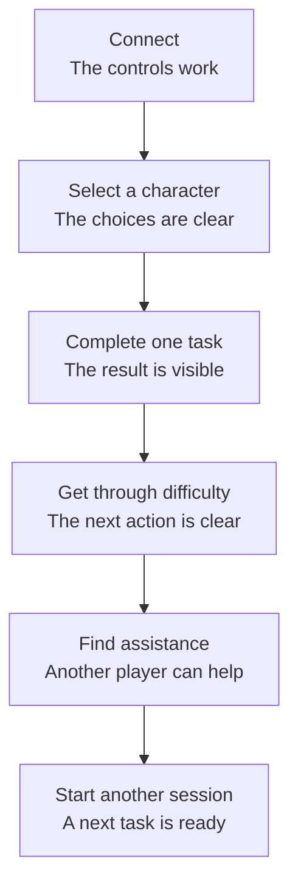
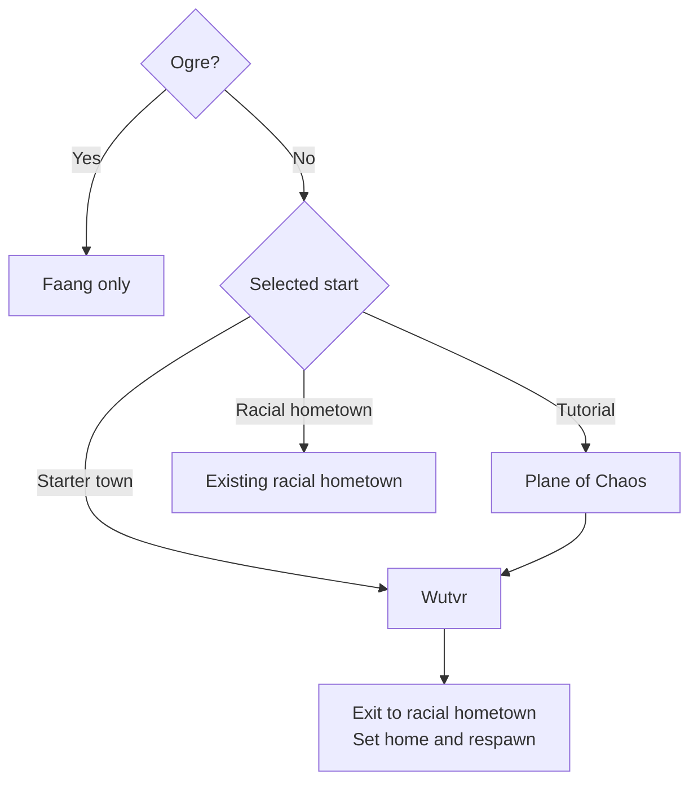
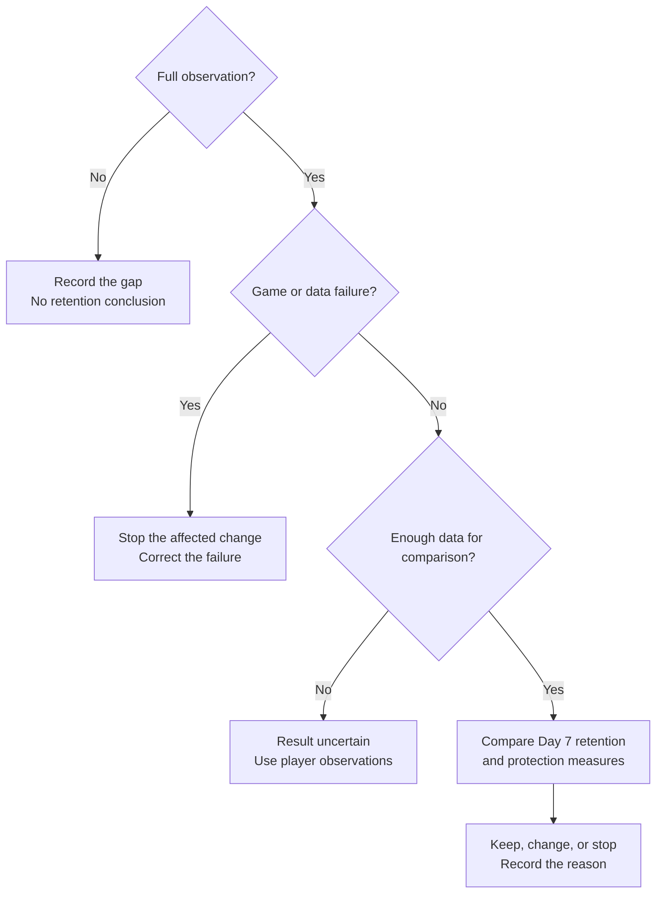

# New player retention

Help new players know what to do, get through their first difficulty, and start another session.

**Status: strategy for review. Date: October 20, 2026.**
This page contains source facts, decisions from issue #213, and proposals.
It does not contain measured retention results.
The changes to the game and data collection are future work.

## Start here

**Make the first session useful. Make the next session easy to start.**

The strategy has three priorities:

1. Apply the death-XP policy and tutorial decisions in issue #213.
2. Give each new player a small task, a recovery procedure, and access to another player.
3. Measure activity in later sessions before more changes to rewards or difficulty.

The first priority has an agreed scope.
The second and third priorities are proposals.
Their effect on retention is unknown.

### Terms in this page

- **New player:** a person who reports no previous Duris experience.
- **Account:** the sign-in identity. One account can have more than one character.
- **Character:** the person or creature that the player controls in the game.
- **Session:** a period of game activity. A short connection failure does not necessarily start another session.
- **Retention:** the proportion of eligible accounts with game activity in a specified later period.
- **Cohort:** accounts with their first world entry in the same specified period.
- **XP:** experience points. XP contributes to character levels.
- **Hometown:** the character's home location.
- **Respawn:** the character's placement after death.
- **Tutorial:** an area that shows the player how to use game controls and rules.
- **PvP:** combat between players.
- **Telemetry:** data that the server records about game operation.
- **Baseline:** the measurements before a change.
- **UTC:** the reference time used for all report timestamps.

Account retention cannot identify every person.
One person can have more than one account.
A new character alone does not identify a new player.

## What the source shows

The source inspection used revision
[`9e2a7b457cf7`](https://github.com/LuminariMUD/Duris/commit/9e2a7b457cf7464812cba3b5ab21f4315272c14c).
The live server configuration and player behavior were not part of this inspection.

### Death-XP rules are different between sides

The normal death-XP calculation has a good-side condition.
The repository property sets its level limit to 30.
The C++ default is 20 if the property is absent.
Thus, the repository setting does not prove the live setting. [Sources: death calculation][death] and [property][property]

The death handler also has a separate Lich level-loss path.
A change to the normal XP calculation alone does not prove protection for every race.
The implementation must include all applicable death paths. [Source: death handler][death-handler]

**Possible retention effect:** early death can remove progress before a player knows the recovery procedure.
This is a possible cause of departure, not a measured cause.

### Tutorial choices depend on race

The hometown table includes Ailvio and Plane of Life choices for eligible good races.
It does not include the planned Wutvr and Plane of Chaos choices.
Terminal creation uses this table to show and validate hometown choices. [Sources: hometown table][homes] and [creation code][creation]

**Possible retention effect:** players can have different opportunities to practice before their first difficult encounter.
The number of players affected is unknown.

### The new-player flag is a player answer

Terminal creation has a question about previous Duris experience.
The answer can set the new-player flag.
This flag is useful for assistance, but it is not proof of a new account or person. [Source: new-player selection][new-player]

### Existing reports do not measure new-player retention

The login exporter counts daily accounts.
It removes duplicate logins for the same account.
It does not include staff logins.
Its public output contains totals, not the account history necessary for a retention calculation. [Source: login statistics](../operations/LOGIN_STATS.md)

The telemetry contract uses character identities.
It does not include account linkage.
Telemetry is off by default.
The existing return report is not an account-retention report. [Sources: telemetry contract](../telemetry/CONTRACT.md) and [reports](../telemetry/REPORTS.md)

**Result:** a retention baseline is not available from these totals alone.
No retention percentage is claimed on this page.

### Claims without current measurements

Issue #213 contains historical claims about hostile creatures, a hometown-change price, and the first hour.
Those claims are not current measurements.
This strategy does not use them as measured facts.
The Power Atlas is also a historical combat model, not a record of player departures. [Source: issue #213][issue]

## The player path

Each stage has a player result.
A failure at one stage can prevent the next result.
This diagram shows a proposed path, not measured conversion rates.

If a diagram is wider than your screen, scroll the diagram sideways.

The same path applies to terminal and web clients.
A browser visit is not world entry.
A connection is not proof of game activity.

### First 5 minutes: a clear start

**Proposal:** show the available tutorial path before the hometown selection.
Use the same names in the client, help text, and game.
Tell players when their race has no tutorial choice.

**Acceptance:** a new player can select an eligible start without assistance from staff.
The server rejects ineligible choices in both clients.

### Minutes 5 to 15: one completed task

**Proposal:** use one existing tutorial task with movement, examination, and a visible result.
Give the necessary command before its first use.
Keep the task and reward unchanged in the evil copies.

**Acceptance:** the player completes the task and knows the result.
A staff command or gift is not necessary.

### Minutes 15 to 30: a recovery procedure

**Proposal:** give short instructions for the next action after a defeat or loss of direction.
Include the character's location, the next useful command, and a way to get assistance.
Use text as well as color.

**Acceptance:** after a controlled local defeat, the player can continue.
XP, equipment, location, and respawn behavior agree with the applicable rules.
Death-XP protection does not mean protection from every death consequence.

### Minutes 30 to 60: assistance and a next task

**Proposal:** give access to an available volunteer through existing communication tools.
Make this optional.
If no volunteer is available, give a task that the player can do alone.

Before the player stops the session, give one specified next task and its start location.
Tell the player how to sign in again.
Do not make a reward depend on daily attendance.

**Acceptance:** the player can state the next task and the way to get assistance.
The next session starts with the correct character state.

These time ranges are design targets.
They are not measured completion times or deadlines for players.
Additional help messages are separate proposals, outside the minimal tutorial-copy scope.

## Keep the agreed game rules

The body of issue #213 records these decisions.
The issue was open at the time of inspection.
Implementation and gameplay acceptance stay open. [Source: issue #213][issue]

### One death-XP rule below level 30

- Prevent death-XP loss below level 30 for every race and side.
- Apply ordinary death rules from level 30.
- Show a prominent, bold, ALL-CAPS message when a character gets to or crosses level 30.
- Include XP loss and level loss in that message.
- Include gains that cross several levels.

Ogre and Firbolg tutorial exclusions do not change this death-XP rule.

### Minimal evil tutorial copies

Plane of Chaos is the copy of Plane of Life.
Wutvr is the copy of Ailvio.
The copies keep the same layout, tasks, mechanics, difficulty, and rewards.

Only necessary names, races, faction text, identifiers, references, and connections change.
A race substitution must not change encounter difficulty.
The tutorial-copy work does not include a general rewrite.

### The evil start route

For races with a side selection, evil tutorial eligibility follows the selected evil side.
This does not make additional races available.
Terminal and web creation must have the same rules and server validation.

Good-side choices stay unchanged.
Firbolgs keep Ugta only.
Ogres keep Faang only.
Wutvr uses the racial hometown as its exit destination.
Shady is not a general exit destination.

Existing aggressive creatures near evil hometown starts stay unchanged.
Access to Shady and Tharnadia does not expand.

A later issue comment proposes changes to hometown aggression and Ogre access.
Those proposals are different from the recorded decisions.
This strategy does not use them. [Source: later discussion][discussion]

**Risk:** the difficulty after the tutorial can still be too high.
Measure departures at that boundary.
If results show a problem, give the facts to the owner for a separate policy decision.

## Work in this order

### 1. Get the baseline

**Owner role:** a data maintainer, with one game designer.

1. Record the source revision, game mode, configuration, and observation period.
2. Do terminal and web walkthroughs for each eligible start.
3. Include Ogre, Firbolg, and races with a side selection.
4. Record the first point where each participant cannot continue without help.
5. Record connection failures separately from game difficulty.
6. Select the retention definitions before data collection.

**Exit condition:** the team has a route record and a list of measured failures.
Unknown measurements have an explicit label.
No live retention calculation starts until its data and identity rules have approval.

### 2. Implement issue #213

**Owner roles:** an engine maintainer and a world builder.

1. Apply the shared death-XP threshold to all applicable paths.
2. Add the threshold message.
3. Make the two minimal tutorial copies.
4. Connect creation, quests, exits, home, and respawn.
5. Do the local acceptance journeys below.

**Exit condition:** the full route works with the agreed rules.
The original tutorials still work.
The owner's separate permission is necessary for production installation.

### 3. Do a small player test

**Owner role:** a playtest coordinator.

Use six to eight volunteers with no previous Duris experience.
This proposed group can help the team find problems.
It cannot give a reliable retention estimate.
Include both clients, both sides, and a session without an available helper.
Do not claim full race coverage from this small group.

1. Give each participant the same first task.
2. Monitor the session without instructions for each command.
3. Record where the participant cannot continue without another person's help.
4. Record whether the participant can continue after difficulty.
5. Record the participant's description of the next task.
6. Get permission for one later question about their experience.

The final question can be: “What stopped you from starting another session?”
Record the answer separately from measured game events.
Do not infer a reason from silence.

**Exit condition:** the team can reproduce each reported problem.
The next change corrects one identified problem.

### 4. Measure a controlled change

**Owner roles:** a data maintainer and the game owner.

First measure the effect of the issue #213 package.
Then examine the additional help and next-task proposals separately.
A package result cannot identify which part caused a change.

1. Select the comparison period and minimum useful effect before the experiment.
2. Calculate the necessary sample from the baseline and that effect.
3. Keep rewards, sources of new players, game mode, and helper coverage as consistent as possible.
4. Record unavoidable changes and server outages.
5. Wait until each account has its full observation period.
6. Compare retention and the protection measures below.

**Exit condition:** the report shows counts, uncertainty, and data gaps.
If traffic is insufficient, state that the result is uncertain.
Do not extend the experiment only until a favorable percentage appears.

## Measure the correct result

These definitions describe future measurements.
They are not claims about existing reports.

### Who belongs in the measurement

Use accounts whose creation and first successful world entry are known within a period of continuous data collection.
Record the first world entry as time zero.
Use UTC timestamps.
Put each account in one cohort, based on the week of its first world entry.

Do not include staff, test accounts, or known existing accounts.
Keep unknown history in a separate count.
An account's first appearance in a new report is not necessarily its first visit to Duris.

Record the player's answer about previous Duris experience separately.
Show the new-player subgroup separately from all eligible new accounts.
Do not infer that subgroup from character level.

### What counts as a return

A **qualifying return** has a later session and a player-initiated game action within the specified period.
Movement or a completed game task can be suitable actions.
A login alone, idle connection, heartbeat, or automatic client command is insufficient.

The implementation must specify accepted action types before collection.
It must also distinguish a resumed session from a new session.
Count each account once per return measure, across its characters and clients.

- **Day 1 retention:** a qualifying return from 24 hours to less than 48 hours after time zero.
- **Day 7 retention:** a qualifying return from 168 hours to less than 192 hours after time zero.
- **First-task completion:** a completed selected task within 60 elapsed minutes after time zero.
- **First-hour death exposure:** at least one character death within those first 60 minutes.

All four measures use eligible accounts with the full relevant observation period.
Task completion and death exposure describe the first hour.
They do not replace retention.

### The calculation

Retention percentage equals 100 times the accounts with a qualifying return, divided by eligible accounts with full observation.

Show both account counts beside each percentage.
If no account is eligible, show “No eligible accounts.”
If the period is incomplete, show “Waiting for full observation.”
Missing data does not mean no return.

If an outage prevents observation, show the affected accounts separately.
Do not include them in the result with full observation.
Show their number so the reader can see possible bias.

For each comparison, show a 95% confidence interval.
This interval shows statistical uncertainty.
It does not remove bias from an outage, volunteer selection, or a change in the player population.

### Separate useful groups

Compare good and evil starts, tutorial and direct starts, and terminal and web entry.
Use the selections at first world entry.
Keep later client changes visible in the source data.
Separate ordinary play from Chaos mode and from different seasons.

Do not divide a small sample into many race and class groups.
Show counts before percentages.
Use more observation periods together only when their rules and data quality agree.

## Collect only the necessary data

The existing telemetry design is the first system to examine.
A browser-only tracker cannot observe terminal game activity.
Browser replay alone cannot prove a server-side quest result.

The proposed minimum record contains:

- An approved account code and character code without names.
- An event identifier, UTC timestamp, and session identity.
- The first world entry and selected start.
- The selected task result and first-hour death occurrence.
- The accepted action category for a qualifying return.
- The client type, game mode, season, and configuration version.
- Data-gap and test-account indicators.

These are proposed data requirements, not existing event names or fields.
Account linkage is additional work under the current telemetry contract.
The data owner must set access, deletion, and storage-duration rules before activation. [Source: telemetry contract](../telemetry/CONTRACT.md)

Keep passwords, account names, IP addresses, chat text, and raw command text out of this measurement.
Do not copy private event records to the public site.
Use aggregate results with the small-group publication rule agreed by the data owner.

If approved account linkage is unavailable, use consented playtest observations.
Use the label “Participant observations” for those results.
Do not use the label “Account retention” for character-return results.

## Use the results

The primary result is Day 7 retention.
Day 1 retention and first-task completion help the team find problems earlier.

The protection measures are:

- Creation failures and failed world entries.
- Unintended XP or level loss below level 30.
- Incorrect equipment, rewards, home, or respawn state.
- Server failures or additional time for each game update.
- Requests for assistance and time spent by helpers.
- Player reports of pressure, confusion, or harassment.

A new progression or persistence failure stops the affected change.
Correct that failure before more player exposure.
Do not remove the agreed death protection merely because a retention estimate is uncertain.
Game-rule policy and experiment conclusions are separate decisions.

Higher retention after a release is an association.
A before-and-after comparison alone cannot prove the release caused the difference.
Season resets, recruitment, class changes, and helper availability can also change the result.

## Acceptance before live use

These are requirements for later implementation.
The site build does not prove gameplay acceptance.

1. Do death tests at levels 1, 2, 29, and 30 for both sides.
2. Include applicable special race paths, Ogre, and Firbolg.
3. Make sure no death path removes XP or levels below 30.
4. Do threshold-message tests for a normal gain and a gain across several levels.
5. Do both creation flows, including invalid selections and side changes.
6. Complete each tutorial route with normal character equipment.
7. Compare copied quests, encounters, and rewards with the originals.
8. Make sure the final home and respawn are correct after reconnect and restart.
9. Do a direct-hometown journey without a helper.
10. Do data tests for duplicate events, alternate characters, reconnects, missing periods, and observation-period boundaries.
11. Make sure disabled or failed telemetry does not prevent game operation.
12. Record the installed version and the owner's production permission.

## Language and sources

This page uses the writing rules in
[ASD-STE100, Issue 9](https://www.asd-ste100.org/assets/files/ASD-STE100_ISSUE9.pdf).
Instructions use short, direct sentences.
Descriptions use one subject per paragraph.
The game and measurement terms above have the same meaning throughout this page.
Code identifiers, place names, and interface labels keep their original spelling.

The language inspection includes sentence length, instruction structure, and selected dictionary checks.
Full dictionary conformance has not had independent verification.
This is an authored application of the standard, not an ASD certification.

The source links below identify the inspected revision.
Issue discussions can change after the date of this page.

- [Normal death-XP calculation][death].
- [Repository death-XP threshold][property].
- [Death handler and special race path][death-handler].
- [Hometown eligibility table][homes].
- [Terminal hometown selection][creation].
- [New-player flag selection][new-player].
- [Issue #213 and its recorded decisions][issue].
- [Later proposals about aggression and Ogre access][discussion].
- [Daily account login statistics](../operations/LOGIN_STATS.md).
- [Telemetry identity and activation limits](../telemetry/CONTRACT.md).
- [Telemetry report limits](../telemetry/REPORTS.md).
- [Existing study limits on causal claims](../telemetry/studies/rested-bonus.md).

[death]: https://github.com/LuminariMUD/Duris/blob/9e2a7b457cf7464812cba3b5ab21f4315272c14c/src/world/limits.c#L1373-L1380
[property]: https://github.com/LuminariMUD/Duris/blob/9e2a7b457cf7464812cba3b5ab21f4315272c14c/lib/duris.properties#L792
[death-handler]: https://github.com/LuminariMUD/Duris/blob/9e2a7b457cf7464812cba3b5ab21f4315272c14c/src/combat/fight.c#L2546-L2563
[homes]: https://github.com/LuminariMUD/Duris/blob/9e2a7b457cf7464812cba3b5ab21f4315272c14c/src/core/constant.c#L1792-L1844
[creation]: https://github.com/LuminariMUD/Duris/blob/9e2a7b457cf7464812cba3b5ab21f4315272c14c/src/account/nanny.c#L3029-L3070
[new-player]: https://github.com/LuminariMUD/Duris/blob/9e2a7b457cf7464812cba3b5ab21f4315272c14c/src/account/nanny.c#L2170-L2194
[issue]: https://github.com/LuminariMUD/Duris/issues/213
[discussion]: https://github.com/LuminariMUD/Duris/issues/213#issuecomment-6277411612
