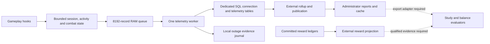

# Telemetry feasibility, cost, and readiness review

Reviewed 2026-10-13 against `1a529fa05c1af258b226258b6c9b48021e0908f8`.
This is an assessment of the current implementation, with local measurements
and recommendations. It does not activate telemetry or change server behavior.

Follow-up work: [GitHub issue #59](https://github.com/LuminariMUD/Duris/issues/59).

**Deployment constraint, confirmed 2026-10-13:** collection, storage, rollups
and reports must fit on the existing shared host alongside gameplay and player
saves. Another machine is not available in the near future. A design that needs
one is not feasible for this deployment. If measurements exceed the host's
budgets, reduce telemetry scope and cost or leave collection disabled.

**Recommendation: keep the architecture, fix reporting compatibility and
monitoring of capture failures, then qualify it under representative gameplay
before enabling continuous collection.** The bounded memory footprint and
asynchronous writer are sensible for Duris. The main concerns are event volume,
database work, reporting completeness, and ongoing operational ownership.
Feasibility on this host remains unproven. Passing component tests does not
establish that the full system is a working, low-cost analytics service.

The most consequential findings are:

- **The current rollup stops on record types the current server emits.** It
  accepts kinds 1–5; progression, encounter, and combat-summary records are
  kinds 6–8. This is a reproduced integration blocker.
- **The minute-based storage estimates understate the possible workload.**
  Progression records are emitted at XP mutation attempts, including damage,
  healing, and tanking paths. These can dominate activity intervals.
- **Memory is modest and bounded; hot-path CPU is bounded but variable.**
  Major fixed structures total approximately 4.64 MiB on this build. Combat
  lookup cost increases substantially as encounter/actor tables fill.
- **A batch is one transaction, but still many SQL requests.** An ordinary
  interval for an existing session requires seven statements, plus the
  transaction boundaries. Asynchronous execution does not remove contention
  for the shared database's resources.
- **The outage journal has recurring disk work even at low event volume.**
  Roughly once per second it rewrites its retained producer history and
  synchronizes both the file and directory.
- **Healthy transport does not prove complete capture.** A refused 257th
  resident session, an exhausted configuration registry, and failed journal
  samples can all coexist with healthy transport and zero queue-drop counters.
- **The running server is disabled for telemetry.** There is no measured
  enabled-production CPU, latency, or storage baseline in this review.

## What exists today



The ingest stream contains activity intervals, session lifecycle/checkpoints,
coverage gaps, effective configuration, progression, encounters, and combat
summaries. Combat totals accumulate in memory and are emitted at encounter
close; they do not create one damage-summary row per hit. Progression is a
separate producer and can still create a row for a damage-related XP attempt.

There are **11 telemetry SQL tables** in the migration chain: nine for facts,
configuration, session projections, rollups and quarantine, plus two reward
projection tables. The reward projection reads committed currency, epic and
combat-frag ledgers, with outcome tables supplying context. It has separate
reconciliation semantics because those authorities can commit out of order.

The administrator report catalog implements playtime, cohort, return,
UTC-day activity, and faction views. The return view measures multiple logical
sessions per subject; it is not account retention. Progression/reward/combat
reports are not provided by that catalog. The rested study and balance tools
consume qualified, redacted exports; the application evaluator returns an
intent with zero writes. They are useful building blocks, not a connected
automatic balancing system or a finished dashboard.

Sources: [runtime](../../src/telemetry/telemetry_runtime.c),
[record contract](../../src/telemetry/telemetry_types.h),
[report interface](../telemetry/REPORTS.md),
[reward projection](../telemetry/REWARD_PROJECTION.md),
[study protocol](../telemetry/studies/rested-bonus.md), and
[application boundary](../telemetry/balance/APPLICATION.md).

## What is well designed

The normal capture path performs value operations and bounded admission, with
SQL and journal I/O owned by a separate worker. It does not borrow the gameplay
SQL pool or put observations ahead of authoritative saves in the persistence
queue. The SQL factory requires separate telemetry credentials. One
database-scoped advisory lock prevents multiple ingest writers from breaking
the committed-cursor assumption. Each database therefore supports one ingest
writer: another game process targeting that database cannot ingest
concurrently, even with a different environment or season ID.

The queue cannot grow indefinitely. Admission failures, unknown crash tails,
quarantined records and stale checkpoints have explicit meanings. Immutable
retry identities and absolute checkpoint totals avoid adding the same duration
twice. Ambiguous commits block newer batches until reconciliation. This is
substantial correctness work worth preserving.

Historical context is captured with configuration/version identity instead of
being reconstructed from today's character state. Reports distinguish observed
coverage from absolute checkpoints, retain provisional flags, and use null for
missing denominators. These counters overlap: connected time is
active + idle + unknown, and resident time is connected + linkdead. Interval
coverage and absolute checkpoint totals are alternative evidence about time;
adding them would double count it.

Cached health, `world telemetry`, and payload-free `telemetry_health` log events
provide useful operational visibility without running historical queries in
the game loop. Flat-file mode explicitly disables SQL telemetry.

Sources: [transport](../../src/telemetry/telemetry_transport.c),
[repository](../../src/telemetry/telemetry_repository.c),
[health](../../src/telemetry/telemetry_health.c), and
[SQL connection contract](../telemetry/DATABASE.md).

## Readiness problems and limits

### 1. Mixed record streams currently break rollups

`_validate_common_row()` in
[rollup_engine.py](../../scripts/telemetry/rollup_engine.py) rejects every
`record_kind` outside `range(1, 6)`. The runtime's current enum also defines
progression 6, encounter 7 and combat summary 8. The database adapter reads the
global ingest stream without a record-kind filter, and validation occurs before
scope filtering. Therefore even a newer-kind fact from another scope can stop
a rollup invocation. A failing page cannot advance its committed cursor.

This was reproduced offline: the existing normal interval fixture was accepted;
changing only its kind discriminator to 6, 7 or 8 produced
`unsupported raw telemetry record_kind N`. The rejection occurs before any
kind-specific payload interpretation, so supplying the additional payload
columns cannot fix it. The adapter's `RAW_COLUMNS` also lacks the new payload
and encounter/combat scope fields.

There is related contract drift: the C++ contract permits cardinality-overflow
quality bit 9 (`512`), while the rollup raw-quality mask only accepts bits 0–8.
An otherwise accepted interval with bit 9 was rejected as an unknown raw bit.
This is a compatibility probe, not a claim that today's interval producer
normally sets that bit.

**Required next change:** define how every supported record kind affects the
global watermark, scope and quality, even when it contributes nothing to a
playtime aggregate. Update selected columns and quality handling together, then
test a real mixed stream through SQL ingestion, rollup, publication and report.
Simply widening the accepted integer range is insufficient: later code assumes
a logical session identity that encounter/combat facts do not share.

There is no existing environment switch for a session-only rollout. Enabling
the runtime also enables the other wired producers. A staged subset would
require an explicit implementation change.

### 2. Capacity tests do not establish player capacity

Session and activity state each have **256 slots**, shared by tracked resident
sessions, including detached sessions awaiting retirement. Closed slots can be
reused. A full table refuses additional tracking; increasing queue size does
not increase this limit. Detached-session retirement is configured at **one
hour**, independently of the default five-minute active window. Two hundred
connected characters leave 56 slots for detached residents and churn.
A thousand simultaneous tracked characters are outside the current capacity.

Encounters have separate limits: 128 active runs, 64 participants per run,
256 events per run and a 64-entry terminal cache. Combat summaries allow 128
active encounters and 64 actors each. Overflow means incomplete observations,
not gameplay capacity enforcement. The actor limit includes players, pets and
NPC opponents retained across the entire run; marking an actor inactive does
not free its slot. It can fill during a long run with far fewer than 64
simultaneous players. The encounter event cap also applies to close and
participant-summary events: exhausted roster-event capacity can suppress the
terminal evidence before it even reaches the queue.

Configuration has lifetime limits too: a four-entry pending FIFO, a 64-entry
identity registry, and 64 admitted activity configurations. Identities are not
evicted during that runtime lifetime. A 65th distinct configuration can block
capture even with an empty queue. The reviewed property catalog separately
holds at most 64 digests and is loaded at environment bootstrap. These limits
belong in configuration-change and long-run qualification, not just player-load
testing.

The existing performance gate's 50/200/1,000 profiles are **numbers of synthetic
records**, not concurrent players, encounters, or real command streams. Its
source check covers queue/transport files; it does not prove that every gameplay
adapter or classifier operation has the same cost.

Sources: [session limits](../../src/telemetry/telemetry_session.h),
[activity limits](../../src/telemetry/telemetry_activity.h),
[encounter limits](../../src/telemetry/telemetry_encounter.h),
[configuration state](../../src/telemetry/telemetry_config_private.h), and
[performance gate](../telemetry/PERFORMANCE_GATE.md).

### 3. Completeness and analysis still need integration

The outage journal preserves registrations and sampled watermarks across
process death, but it does not replay lost payloads or feed historical outage
coverage into rollups/reports. A report cannot infer complete incident coverage
merely because its ingest cursor caught up.

The activity classifier's default active window is five minutes. That is a
policy for classifying evidence, not a measurement of a person's continuous
attention. Eight context segments per minute bound detail by degrading excess
changes to unknown context. Sparse class/race/level/zone/configuration cohorts
can still yield weak comparisons even when ingestion works perfectly.

Encounter duration is a run/roster duration, not automatically time fighting a
single mob. Combat start can join an existing group run; stopping combat or an
ordinary NPC death does not itself close that run. Zone departure, participant
departure/death, explicit completion and process lifecycle are different
boundaries. Validate those semantics against the intended balance question.
Also, `dropped_participant_count` in combat summaries counts failed actor-add
attempts: repeated observations of the same excluded actor can increment it
again. It is not a distinct omitted-player count.

Progression facts describe observed mutable XP, not proof that a matching save
committed. Reward projections have stronger amount authority but still require
reconciliation and retained source history. Control-application metrics have
an API, but the source search found no gameplay caller of
`telemetry_runtime_game_combat_control`; zero control observations must not be
reported as evidence that no control effects occurred.

Loss is not necessarily representative: queue pressure disproportionately
rejects detail, and actor/segment caps affect busy fights and frequent context
changes. Comparing only complete rows can therefore select quieter play.
Reports need coverage by the compared cohort and record family, explicit
exclusions, and separate treatment of incomplete runs; a global loss percentage
cannot establish an unbiased XP or contribution comparison.

My preferred first use is descriptive playtime and activity with visible
coverage. XP pacing and encounter contribution are useful next steps once their
report adapters exist. I would keep balance decisions manual and avoid causal
or account-retention claims from the current data model.

Sources: [outage storage](../telemetry/OUTAGE_STORAGE.md),
[activity semantics](../telemetry/ACTIVITY.md),
[progression semantics](../telemetry/PROGRESSION.md),
[encounter implementation](../../src/telemetry/telemetry_encounter.c), and
[combat accumulator](../../src/telemetry/telemetry_combat_summary.c).

### 4. Transport health misses failures before and beside the queue

`telemetry_runtime_health_copy()` exposes transport health. It does not merge
session/activity slot refusals, unavailable configuration, or combat-state
capacity into that health snapshot. Most gameplay callers discard capture
results. An offline probe filled all 256 resident slots, then attempted a valid
257th entry: the entry returned `queue_full`, emitted no record and reported
`records_dropped=0`; transport remained healthy with both drop counters zero.
A second probe admitted 64 distinct configuration identities and rejected the
65th; the visible configuration became unavailable while transport was still
healthy with zero drops. Thus `queue_full` can describe producer-state
exhaustion even when the transport queue has space.

There is a separate journal blind spot. Startup registration failures open the
telemetry circuit, but `worker_outage_guard::checkpoint()` intentionally ignores
later publication errors. The existing `failed_checkpoint()` runtime test
injects ENOSPC and explicitly asserts `state=healthy` and
`last_storage_check=none`. Capture continuing protects availability, but there
is no corresponding health indication that durable outage evidence is stale.
A failed rename can stop further journal sampling until a fresh open validates
the pending frame.

**Required improvement:** expose producer refusals by reason, occupied/maximum
state slots, configuration availability, and journal last-success age/error
separately from SQL health. Count attempted/admitted/committed facts by kind
and distinguish rejected attempts from distinct lost observations. Test that
each of these failures is visible through the operator interface. Keeping
gameplay available should coexist with an honest coverage status.

Sources: [runtime health and journal guard](../../src/telemetry/telemetry_runtime.c),
[session admission](../../src/telemetry/telemetry_session.c),
[configuration admission](../../src/telemetry/telemetry_config.c), and
[journal fault journey](../../tests/async/telemetry_runtime_outage.cc).

## Weight on the game process

### Memory

A native C++20 `sizeof` probe against the current headers produced:

| Structure | Bytes | Approximate MiB |
| --- | ---: | ---: |
| Queue, including all 8,192 slots and admission timestamps | 2,490,400 | 2.375 |
| Session state | 252,144 | 0.240 |
| Activity state | 230,768 | 0.220 |
| Encounter state | 410,120 | 0.391 |
| Combat-summary state | 1,391,616 | 1.327 |
| Configuration state | 14,360 | 0.014 |
| Progression state | 72 | <0.001 |
| Transport in-flight and repository retry record arrays combined | 73,728 | 0.070 |
| **Subtotal** | **4,863,208** | **4.638** |

`sizeof(telemetry_record)` is **288 bytes** on this ABI; 512 is the permitted
maximum, not its current size. The queue is a compile-time array, so choosing
a smaller logical capacity would not shrink its storage.

This subtotal excludes smaller runtime bookkeeping, connector allocations,
SQL strings/results, thread stack reservation, and worker journal buffers.
The journal object is 100,392 bytes and its serialized frame grows to 81,984
bytes. A pulse has a 36,864-byte local counter-update array. SQL and rollup
process memory are additional costs. [Gameplay structs](../../src/core/structs.h)
also retain three 64-bit telemetry identity fields per character, including
NPCs, and connection identity plus a deferred handoff per descriptor. Those
per-object fields exist even when collection is disabled and are outside the
fixed-state subtotal.

These are object sizes, not an enabled-minus-disabled RSS measurement. Static
storage remains part of the binary when telemetry is disabled; how much is
resident depends on initialization and page use. Existing binary symbols
corroborated the queue, runtime state and batch-array sizes. My assessment is
that RAM is unlikely to be the first bottleneck at the current limits.

### Capture and combat CPU

The existing offline capacity gate passed with five repetitions per workload:

| Synthetic records per repetition | Enqueue/batch stage p50 | p99 | Observed maximum | Queue high-water | Drops |
| ---: | ---: | ---: | ---: | ---: | ---: |
| 50 | 0.130 µs | 2.344 µs | 5.851 µs | 50 | 0 |
| 200 | 0.130 µs | 2.345 µs | 9.037 µs | 128 | 0 |
| 1,000 | 0.130 µs | 2.986 µs | 31.399 µs | 128 | 0 |

This stage uses a fake clock and an in-memory repository, with synchronous
batch draining in the harness. It excludes real SQL, the worker's journal,
gameplay adapters, classifier/session scans and concurrent production traffic.
It establishes that queue machinery itself is inexpensive under this fixture.

**Benchmark labeling defect:** both percentile helpers divide by 100 even when
called with `999`, then clamp to the last sample. Fields named `p999_ns` are
therefore sample maxima, not p99.9. The table labels them accordingly. This
makes the current threshold check conservative, but the label should be fixed
before these reports are used for latency qualification.

The higher-risk CPU work is outside that queue microbenchmark. Session and
activity lookup scan up to 256 slots. `telemetry_runtime_pulse()` scans state
and delivers deltas through session lookups. Combat
`find_slot_for_actor()` scans occupied encounters and their participant arrays;
an unsuccessful source lookup can be followed by another scan for the target.

An additional offline probe called the actual combat-summary damage function
10,000 times per repetition, five repetitions, after filling state through its
public begin/add APIs. Successful lookups used the last two actors in the last
occupied encounter. Results are medians of per-repetition **mean** call times:

| Encounter occupancy | Actor lookup | Mean call cost |
| --- | --- | ---: |
| 1 encounter × 2 actors | Present | 0.027 µs |
| 16 encounters × 16 actors | Present at end | 0.969 µs |
| 128 encounters × 64 actors | Present at end | 14.651 µs |
| 128 encounters × 64 actors | Both absent | 29.820 µs |

These repeated, warm-cache synthetic cases exclude runtime adapters and SQL;
the full-capacity cases are stress limits, not estimates of normal play. They
demonstrate why “bounded” does not mean constant cheap work. At 1,000 calls per
second, 14.651 µs/call alone would consume about 1.47% of one CPU core; actual
call rate and occupancy have not been measured. Profile before introducing an
index or increasing limits.

The game loop targets four pulses per second (`OPT_USEC=250000`). Telemetry
defaults to one pulse cohort; configurable staggering can distribute classifier
work, but does not remove every full-state scan. Disabled adapters mostly exit
early, although clock/health calls and some caller-side observation construction
remain. Disabled cost is small in design, not proven to be literally zero.

Every admitted record also notifies the worker. Its normal loop attempts at most
one batch per transport pulse and then waits up to 50 ms, interruptible by new
notifications. A queued burst with no subsequent admissions can therefore
drain more slowly than the synchronous benchmark suggests. At low rates, the
oldest-record flush threshold is two seconds; this is a batching trigger,
not a guaranteed persistence deadline. Measure worker wakeups and sustained
drain alongside per-call capture cost.

Sources: [combat lookup](../../src/telemetry/telemetry_combat_summary.c),
[runtime pulse](../../src/telemetry/telemetry_runtime.c),
[C++ benchmark](../../tests/async/telemetry_capacity_272_harness.cc), and
[Python benchmark](../../scripts/telemetry/benchmark_272.py).

## Database, disk, and network weight

### Rows and retention dominate long-term cost

Current runtime defaults are a 60-second interval, a 300-second checkpoint,
and eight total context segments per minute. For continuously tracked population
`N`, an illustrative activity/checkpoint model is:

```text
ordinary rows/day = N × (1,440 intervals + 288 checkpoints)
high-context rows/day = N × (8 × 1,440 intervals + 288 checkpoints)
total rows/day = those rows + progression + encounter/combat + lifecycle/config/gaps
```

| Continuously tracked characters | Ordinary rows/day | Eight intervals/minute plus checkpoints |
| ---: | ---: | ---: |
| 50 | 86,400 | 590,400 |
| 200 | 345,600 | 2,361,600 |
| 256, the slot ceiling before detached-session pressure | 442,368 | 3,022,848 |

These are workload arithmetic, not expected traffic or a universal emission
ceiling across lifecycle/configuration boundaries. Use time-weighted population,
not peak logins, for a realistic estimate.

For planning only, **assume 1 KiB per raw fact including indexes**. At 200
characters the two scenarios imply about **9.9–67.6 GiB over 30 days**, before
rollups, session projections, backups, redo/binlogs and all other record kinds.
At 0.5 or 2 KiB per fact, halve or double that estimate. Actual InnoDB bytes per
mixed fact must be measured; the 288-byte in-memory record is not a SQL row-size
estimate. The raw table now has five secondary indexes, and updates and
aggregate membership also amplify writes. InnoDB secondary records include
primary-key columns. [MySQL index documentation](https://dev.mysql.com/doc/refman/8.4/en/innodb-index-types.html)

The major omitted term is progression. `gain_exp()` emits a progression
observation at its mutation boundary even when the resulting applied XP is
zero. Damage to a new mob HP low, healing and tanking can reach this path.
As a sensitivity example, **200 characters averaging one admitted XP fact per
second would add 17.28 million facts/day**, or about **16.5 GiB/day** at the
same assumed 1 KiB. That rate is not an observation of this server; it shows
why measuring record counts by kind matters more than counting players alone.

Measure storage on a disposable database after representative mixed ingestion
and rollups: report raw-table data/index growth per admitted fact, aggregate and
membership growth, and redo/binlog/backup volume separately. Repeat with an
aged dataset and rebuild generation. A tiny freshly created table's allocated
pages and one average bytes/fact value are poor forecasts for every record mix.

The lifecycle manifest still retains telemetry with unresolved retention
decisions; there is no automatic raw-data purge in this pipeline. Bounded RAM
does not bound SQL history, backups, report caches or archived outage chains.
Set a storage budget and retention/rebuild policy before continuous collection.
Subject IDs and PIDs also make these records linkable observations even though
they omit names, IPs and chat. Restricted roles and an implemented subject
processing route remain part of operating the system.

Sources: [XP boundary](../../src/world/limits.c),
[damage/healing hooks](../../src/combat/fight.c),
[migrations](../../migrations/immutable/0014_telemetry_storage.sql), and
[lifecycle inventory](../../migrations/data_lifecycle_manifest.json).

### Transaction batching is not SQL request batching

For a valid new interval belonging to an existing session, the repository does:

1. `SAVEPOINT`.
2. Replay-identity lookup.
3. Configuration lookup.
4. Session lookup with `FOR UPDATE`.
5. Raw-fact `INSERT`.
6. Session projection `UPDATE`, including last-ingest/quality bookkeeping.
7. `RELEASE SAVEPOINT`.

The transaction adds `START TRANSACTION` and `COMMIT`. A 128-interval batch is
therefore approximately **898 serial SQL requests**, not one bulk insert.
Progression for an existing session follows the same seven-request path.
Encounter/combat facts normally use five requests per record because they have
configuration checks but no logical-session projection. Checkpoint revision
checks, new-session insertion and error handling add work.
The implementation builds SQL strings on the worker and uses `mysql_real_query`.

At an illustrative 1 ms round trip, 898 requests alone take roughly 0.9 seconds
before other database work; this is an arithmetic latency floor, not a measured
database result. The default endpoint is shared with authority persistence, so
even a private connection still competes for CPU, buffer pool, disk and commit
resources. Batches reduce transaction overhead, but not these per-record
round trips. MySQL documents multi-row inserts as a way to reduce communication
overhead; any optimization here must preserve replay checks and record-level
failure isolation. [MySQL bulk-insert guidance](https://dev.mysql.com/doc/refman/8.4/en/optimizing-innodb-bulk-data-loading.html)

That 1 ms interval/progression example caps ideal full-batch service at about
**143 records/second**, before execution, worker waits and journal work. The
illustrative 200 XP facts/second above would already exceed it. This is a
sensitivity calculation, not measured capacity. For measured input rate
`lambda`, service rate `mu` and pending count `Q`, a growing backlog consumes
remaining capacity at `lambda - mu`; recovery needs `mu > lambda` and takes
approximately `Q / (mu - lambda)` seconds while new input continues. A larger
queue buys burst time and cannot fix a sustained service deficit.

Budget one ingest connection plus external analytics connections. Serialize
external jobs operationally: one connection per tool instance does not prevent
several operators or schedulers from launching concurrent jobs. A separate
schema on the same instance would not provide hardware isolation. Moving work
to another machine is outside the near-term deployment budget.

### The outage journal is a small file with recurring synchronization cost

`worker_outage_guard::checkpoint()` samples about once per second. Each
successful publication serializes **64 + 320 × retained producer lifetimes**
bytes, writes a replacement file, calls `fsync(file)`, renames it, and calls
`fsync(directory)`. It does this even if there are few gameplay facts.

| Producer lifetimes retained in current chain | Bytes per sample | Logical bytes written/day at one sample/sec |
| ---: | ---: | ---: |
| 1 | 384 | 33.2 MB |
| 64 | 20,544 | 1.78 GB |
| 256 | 81,984 | 7.08 GB |

These are overwritten logical bytes, not daily retained disk growth or measured
physical device writes. Filesystem journaling and device behavior add their own
costs. The cadence also means roughly two synchronization calls per second;
slow storage can reduce the actual rate and delay the same worker's SQL drain.
At 256 lifetimes the implementation archives the chain and starts another;
it no longer simply stops at that count.

The once-per-second cadence describes successful samples. A failed write
restores the old observation timestamp, so the next worker iteration can retry
immediately instead of waiting another second. With a fast failing filesystem
and no intervening SQL or notifications, the 50 ms worker wait permits roughly
20 attempts/second; admissions can wake it sooner. Add bounded retry pacing
and journal-health visibility before relying on the healthy-case I/O budget.

Retain the durable evidence design, but measure synchronization
latency and reconsider rewriting unchanged historical entries at this cadence
if it materially affects the host. Do not assume a sub-100-KiB file has
negligible I/O cost, and do not remove durability without deciding what evidence
may be lost.

Source: [journal implementation](../../src/telemetry/telemetry_outage.c).

### Rollups add material work of their own

An interval can update session, player-day, cohort-day, and subject/session
membership contributions, with additional reads for membership/replay semantics.
Multiple configurations, zones and rebuild generations increase aggregate
cardinality. “Daily aggregate” does not necessarily mean a tiny table.

The external engine has useful row, byte, fanout, statement and runtime budgets
(defaults include 100-row pages, 10,000 rows/invocation and 30 seconds). Reports
have deadlines, keyset pagination and an optional cache. Grouped report `LIMIT`
bounds returned groups, not rows examined; a narrow report can still scan many
aggregate buckets.

Each rollup scope scans the global raw cursor, including other scopes and kinds
that do not add duration. After compatibility is fixed, progression-heavy
traffic will still consume scan budgets unless that access design changes.
Reward projection adds a different workload: bounded forward scans plus
repeated reconciliation over retained authoritative ledgers. Its pages use a
bulk upsert, so the ingest writer's seven-statement-per-fact estimate does not
apply to that job. Include reconciliation catch-up in the shared DB budget.

Report freshness includes interval sealing (normally 60 seconds), queue drain,
scheduled rollup/publication and any cache refresh. No collection setting
establishes an end-to-end freshness guarantee. `playtime` supports subject
filtering only; date-windowed activity uses daily cohort/member outputs.
Published watermarks, provisional coverage and cache age must remain visible.

In the existing synthetic 1,000-record fixture, the pure Python rollup median
was **344 ms** with **2.32 MB peak traced allocations**; report shaping was
**46 ms** with **1.29 MB**. There were no database calls. These measurements
include `tracemalloc` overhead, exclude interpreter baseline memory and are not
end-to-end job throughput. They support keeping reporting outside the game
process and scheduling bounded increments instead of repeated full rebuilds.

## Failure behavior and operational burden

The 8,192-record queue has a 128-record reserve for control traffic. Intervals
and progression are detail; encounter events and combat summaries are control
alongside lifecycle/checkpoint/configuration/gap facts. Thus encounter-close
bursts compete with loss reporting and lifecycle evidence for the reserve.
A 64-participant close can attempt a close fact, 64 participant summaries and
up to 64 combat summaries: more than the 128 slots reserved for all control
traffic if ordinary capacity is already exhausted. The reserve reduces risk;
it does not guarantee retention of critical coverage metadata.

With no drain and continued admission, nominal time to consume 8,064 detail
slots is `8064 / detail_records_per_second`: about 81 seconds at 100/s and
eight seconds at 1,000/s. Actual admission can stop earlier due to the circuit
breaker, existing occupancy or control traffic. This is a transient buffer,
not an outage spool. In-flight records continue to count against capacity;
copying a batch to the worker does not free its slots before reconciliation.
Restarting cannot recover facts held only in RAM, including combat totals not
yet emitted at encounter close. Queue depth alone cannot quantify that loss.

Current startup qualification keeps retrying transient unavailability with a
one-second cap. After readiness, repeated transient batch failures can open
the circuit after eight attempts; permanent failures open it immediately.
Ordinary circuit recovery requires a transport lifecycle restart. Ambiguous
commits retain their stricter reconciliation barrier. Operators need an alert
and recovery procedure, not just an expectation that every outage self-heals.
An open circuit refuses detail immediately but can still admit control records
into remaining queue space; it does not continue draining them. Treat those
records as pending evidence, not a durable fallback channel.

Normal capture avoids waiting for SQL, but lifecycle behavior has exceptions:
copyover requests a flush with up to a 250 ms wait, and final reap joins the
worker after gameplay has ended. Connector timeouts are not proof of a hard
end-to-end shutdown deadline. Qualification should include slow SQL and slow
journal storage during copyover/shutdown.

Activation requires compatible migrations, dedicated writer credentials, a
reviewed effective-property digest catalog, correct season/environment/version
identities, and a protected outage directory. Rollup/report/reward jobs require
their own roles and scheduling. Unknown property fingerprints can refuse
capture; intentional property changes need matching catalog management. These
requirements are justified, but make this a service someone must own.

Environment, season, build, content, classifier and policy IDs default to `1`;
they are not automatically derived from Git or the host's `ENVIRONMENT` label.
Assign them deliberately, especially for restored test worlds and changed
builds. `TELEMETRY_ENABLED` is read at runtime bootstrap; editing an environment
file alone does not reconfigure the running server. The operating procedure
needs an owner, alerts, a qualified stop/restart path, handling for retained
quarantine/pending evidence, and a backup/restore/rebuild exercise that preserves
raw identities, configuration and consumer watermarks together.

The implementation is also substantial: approximately **19,140 lines** under
`src/telemetry` and **10,145 Python lines** under `scripts/telemetry`, excluding
tests, migrations and gameplay hooks. Line counts include comments and do not
measure code quality. They do show that maintenance is a meaningful part of
the cost, especially when separately developed contracts evolve.

## Recommended next work, in order

| Priority | Work | Evidence needed before proceeding |
| --- | --- | --- |
| First | Fix mixed-kind rollup compatibility and quality-mask drift | Current server record families survive a complete ingest → rollup → published report journey; irrelevant kinds advance the cursor safely |
| First | Expose producer and journal failures in operator health | Slot and configuration refusal plus post-startup journal faults are visible even with a healthy SQL connection and an empty queue |
| First | Correct percentile labels and measure record mix/capture cost on an isolated representative game | Enabled/disabled comparisons with commands, movement, combat, XP, groups, reconnects and detached sessions; true latency percentiles and counts by kind/refusal reason |
| First | Choose raw/aggregate retention and disk budgets | Measured bytes/fact, daily growth, backup/rebuild cost, free-space alerts and an approved lifecycle procedure |
| Next | Qualify SQL and journal together with ordinary persistence; bound journal retries | Game-pulse and save latency, writer throughput/backlog, CPU/RSS, SQL lock/commit latency, fsync latency, disk-full retry rate and recovery behavior |
| Next | Finish the first useful report/export path | Descriptive reports with trustworthy coverage, followed by explicit XP/encounter/reward definitions and study adapters |
| Later, if measurements justify it | Reduce high-frequency detail and repeated scans/SQL calls | Compare costs while retaining required XP/source semantics, replay integrity and visible loss; optimize the measured bottleneck |

For load qualification I would use 50, 200 and 256 resident-session cases,
plus overflow/churn tests, and vary combat occupancy independently. A 1,000
player target needs a deliberate capacity change first. Include a long run
with more than 64 successive actors, roster churn through the 256-event cap,
64/65 configuration identities, and detached retirement. Test unknown property
digests, SQL disconnect/reconnect, ambiguous commits, disk full and failed
journal rename, then copyover/shutdown under delayed I/O. Include a long enough
soak to observe journal history, data growth and rollup catch-up.

Use the same scripted gameplay and data for matched disabled/enabled runs.
Measure capture with a fake repository to separate producer CPU, then real SQL
and journal together, then concurrent rollup/report/reward jobs with ordinary
player saves. Record command/pulse/save latency, process and worker CPU/RSS,
admission/commit rates by kind, producer occupancy/refusals, queue age/depth,
database work and durable/publication lag. Offline queue timings cannot supply
those comparisons.

Fitting the complete pipeline on the existing shared host is a required
acceptance condition. Suggested initial performance criteria are **proposals**,
not existing guarantees:
no normal-load admission loss or slot overflow; no sustained queue growth;
writer and rollup service rates above measured peak input with explicit
headroom; and no more than 5% deterioration in matched game-pulse and
authoritative-save p99 latency, while remaining inside their absolute operating
budgets. Use repeated runs and sufficient samples to separate telemetry cost
from host noise. During injected outages, require gameplay continuity, explicit
incomplete coverage, and successful recovery without duplicate totals. Any
normal control loss or sustained backlog should block rollout.

If measurements call for optimization, choose the smallest change for the
observed cost. Repeated configuration lookups are a candidate for per-batch
reuse; reducing serial SQL requests must retain savepoint isolation, exact
replay and ambiguous-commit recovery. XP coalescing or sampling needs an explicit
contract for attempted/applied amounts, zero-application counts, source/modifier
and configuration/level boundaries; silently dropping zero-applied attempts
would remove useful cap/denial evidence. An actor index needs lifecycle tests
for reuse and departures. None of these changes is justified solely by a faster
enqueue benchmark.

Retain the queue/worker design while connecting the reporting contracts and
making capture failures visible. Define the questions before reducing event
volume, and preserve the distinction between observation and gameplay authority.
If measured database interference remains excessive, reduce collection detail,
retention or report frequency while preserving explicit coverage and useful
report semantics. Requalify that smaller system on the existing host. If it
still cannot meet gameplay and save budgets, keep telemetry disabled and record
that the proposed scope is not currently feasible.

## Evidence and reproducibility

The checkout declares `ENVIRONMENT=production`. Read-only inspection found the
running process had no `TELEMETRY_ENABLED`, writer credentials or property
catalog setting; the latest telemetry health event reported `state=disabled`,
zero admission and zero applied records. The configured outage directory alone
does not activate collection. This inspection did not establish that every
historical telemetry table is empty or that no external analytics job exists.

No live SQL workload, migration, service restart, activation, player session,
retention action or configuration change was performed. Measurements used
synthetic offline data on this shared Linux host, AMD EPYC-Milan, g++ 15.2.0
with `-O2` for microbenchmarks, and Python 3.14.4. They are host snapshots, not
production latency guarantees.

Executed successfully:

- `python3 scripts/telemetry/benchmark_272.py --workloads 50 200 1000 --repetitions 5 --output bin/tests/telemetry-review-capacity.json`
  — all local guards and six fault scenarios passed.
- `python3 tests/async/test_telemetry_runtime_integration.py`
  — fake-repository lifecycle/copyover journeys passed in flat-file and SQL-header builds.
- Focused suites under `tests/async/`: `test_telemetry_combat_summary.py`,
  `test_telemetry_progression.py`, `test_telemetry_encounters.py`,
  `test_telemetry_outage.py`, `test_telemetry_runtime_outage.py`,
  `telemetry_rollup_engine_test.py`, `test_telemetry_reports_contract.py`,
  `test_telemetry_reward_projection.py`, `test_telemetry_study_rested.py`,
  `test_telemetry_balance_shadow_recommend.py`, and
  `test_telemetry_balance_apply_contract.py` — all passed.
- Follow-up verification passed `test_telemetry_health.py`,
  `test_telemetry_session_state.py`, `test_telemetry_activity_state.py`,
  `test_telemetry_combat_hooks.py`, `test_telemetry_gameplay_adapters.py`, and
  `test_telemetry_config.py`, and reran the runtime-outage, rollup-engine and
  report-contract suites. Full outputs and exit codes are retained in
  `bin/tests/telemetry-review-verification.json`.
- Native size and combat occupancy probes described above. The size probe was
  rebuilt against the reviewed headers and reproduced every table entry.
  The original capacity/combat timing artifacts were checked against these
  tables; their numbers are retained measurements, not new enabled-server runs.
  Disposable source, binaries, output and logs are under
  `bin/tests/telemetry-review-*`; they are
  not committed artifacts. The combat probe asserts that all present-actor
  calls are accepted and missing-actor calls are not accepted.
- `bin/tests/telemetry-review-health-probe.cc` reuses the existing runtime
  integration fixture with the actual producer/worker and a fake repository.
  It asserts the 256/257 session and 64/65 configuration boundaries and the
  healthy/zero-drop results described above. Its output is retained in
  `bin/tests/telemetry-review-health-probe.txt`; no live database is involved.

The validator mismatch can be reproduced from the repository root without SQL:

```sh
python3 - <<'PY'
import sys
sys.path[:0] = ['scripts/telemetry', 'tests/async']
from telemetry_rollup_fixtures import golden_rows, FIXTURE_DIR
from rollup_engine import build_page_contributions, SemanticError
from rollup_definitions import RollupTarget

_, rows = golden_rows(FIXTURE_DIR / 'normal_interval.json')
row = next(r for r in rows if r['record_kind'] == 1)
target = RollupTarget(1, 1, row['environment_id'], row['season_id'])
assert build_page_contributions([row], target).fetched_rows == 1
probes = [({**row, 'record_kind': kind, 'environment_id': scope},
           f'kind={kind}, environment={scope}')
          for kind in (6, 7, 8)
          for scope in (row['environment_id'], row['environment_id'] + 1)]
probes.append(({**row, 'quality_flags': 512}, 'quality bit 9'))
for candidate, label in probes:
    try:
        build_page_contributions([candidate], target)
    except SemanticError as error:
        print(f'{label}: {error}')
    else:
        raise AssertionError(f'{label}: expected the reviewed incompatibility')
PY
```

The kind probes deliberately change the discriminator (and test a different
scope) to isolate the early validator rejection; they are not serializers for
complete new-kind records. The independent quality probe tests the raw mask.
The passing suites test their declared components, not the missing mixed-stream
integration. Live-database throughput, actual daily event mix, SQL bytes per
fact, enabled-versus-disabled RSS/CPU, and player-visible latency remain
unmeasured. Those are the remaining evidence needed for a deployment decision.
